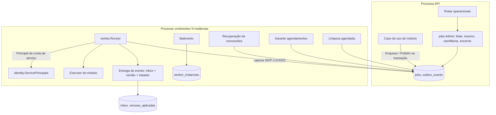

# Platform e processamento — Design

**Spec**: `.specs/features/tj-connect/spec/01-platform-processamento.md` (aprovada em 2026-10-14)
**Status**: Draft — aguardando revisão do mantenedor. Nada aqui foi implementado; nenhuma migration foi criada.
**ADRs**: [011](../../../../docs/adr/011-mapa-de-modulos-do-tj-connect.md), [012](../../../../docs/adr/012-cobrancas-e-eventos-persistentes.md), [014](../../../../docs/adr/014-worker-e-processamento-persistente.md), com [013](../../../../docs/adr/013-contas-de-servico-e-autoria-de-processos.md)
**Decisões do mantenedor**: D3, D-01-1, D-01-2 (2026-10-14)
**Depende de**: design `02` (contas de serviço, `ServicePrincipals`, autoria `service`)

A abordagem (fila própria em PostgreSQL com `SKIP LOCKED`, concessão e token de cerca, outbox com inbox, `cmd/worker` separado) foi escolhida e aprovada na ADR-014 e nas revisões do parecer externo. Este documento detalha a implementação sobre o código atual, sem dependência nova.

---

## Conformidade com decisões ativas

| Decisão | Como este design se conforma |
|---|---|
| AD-001 / AD-014 | Plataforma em `platform/jobs` e `platform/outbox`; módulos só usam as interfaces públicas; executores declarados pelo módulo dono e ligados só no `cmd/worker` |
| AD-002 | PostgreSQL 16, GORM com SQL explícito (padrão de `role_repository.go`), migration `000012` **proposta**; nenhuma biblioteca de fila (ADR-014: só entraria provando enfileiramento na transação GORM) |
| AD-004 | Ações humanas (reenfileirar, encerrar) auditadas na mesma transação; efeitos de negócio auditados pelos casos de uso dos módulos com ator `service` |
| AD-010 / AD-012 / AD-013 | Rotas operacionais novas entram primeiro em `platform.yaml`; todas na cadeia autenticada |
| AD-005 | O worker não tem sessão nem porta; age só com o `Principal` de contas de serviço (design `02`) |

---

## Architecture Overview



- O **API** só enfileira e publica, sempre na transação do caso de uso. Ele nunca executa (INV-P6).
- O **worker** captura, executa com a conta de serviço do tipo, entrega eventos, recupera concessões vencidas, garante agendamentos, faz a limpeza e grava o batimento.
- Todo tempo vem do `now()` do banco (LEA-01 AC5).

---

## Code Reuse Analysis

| Componente | Local | Como é usado |
|---|---|---|
| `database.WithTx`, `TxFrom` | `api/internal/platform/database/tx.go` | `Enqueue`/`Publish` exigem `TxFrom` (falham fora de transação, como o `audit.Recorder`); o runner abre a transação dos executores transacionais e o executor **entra** nela |
| Padrão "exige transação" | `api/internal/platform/audit/recorder.go:46` | Mesmo comportamento e mesmo tipo de erro (`ErrNoTransaction`) |
| `pg_advisory_xact_lock` | `api/internal/identity/infra/role_repository.go:60` | Serializa a sincronização da matriz também quando o worker parte (design `02`) |
| `logx` | `api/internal/platform/logx` | Logs estruturados do worker |
| `config.Load` e helpers de ambiente | `api/internal/config/config.go:60` | `LoadWorker()` reaproveita a leitura de `DATABASE_URL`, `LOG_LEVEL` e acrescenta `WORKER_*` |
| `audit.Recorder`, `audit.Register` | `api/internal/platform/audit` | Auditoria das ações humanas sobre jobs; ações `job.retry`, `job.close` |
| Teste arquitetural | `api/internal/architecture_test.go` | Recebe a lista de setas permitidas e as novas regras (ARQ-01) |
| Testes de migration e testcontainers | `api/internal/platform/database/*_migration_test.go`, `platform/testutil/postgres.go` | Mesmo padrão para `000012` e para os testes de concorrência |
| `httpx.WriteProblem`, cadeia autenticada | `api/internal/platform/httpx`, `api/internal/httpapi/router.go:116` | Rotas operacionais |
| `Dockerfile` (build multi-stage, distroless) | `api/Dockerfile` | Mesma imagem com um segundo binário `/worker` |

---

## Components

### P1 — `platform/jobs`: registro e API para módulos

- **Purpose**: permitir que um módulo registre trabalho na sua transação, restrito ao seu prefixo.
- **Location**: `api/internal/platform/jobs/` (`job.go`, `enqueue.go`, `registry.go`, `errors.go`)
- **Interfaces**:
  ```go
  type Effect string // "nenhum" | "financeiro" | "associativo"
  type Mode string   // "transacional" | "externo"

  type Type struct {
      Name           string        // "<modulo>.<nome>", ex.: "cobrancas.sincronizar"
      ServiceAccount string        // "svc.<modulo>-<processo>" (design 02)
      Mode           Mode          // transacional: efeito + conclusão na mesma transação; externo: faz chamadas externas
      Effect         Effect
      Idempotent     bool          // obrigatório true (REC-01 AC6)
      MaxAttempts    int           // 0 = padrão
      Timeout        time.Duration // 0 = padrão; precisa ser < concessão
      Retry          RetryPolicy   // obrigatória quando Effect != nenhum (DLQ-01 AC9)
      Obligation     ObligationCheck // obrigatória quando o tipo carrega obrigação (DLQ-01 AC6)
      ClosePermission authz.Permission // permissão do módulo dono para encerrar (DLQ-01 AC3)
  }
  type RetryPolicy func(ctx context.Context, j Job) (RetryDecision, error)
  type RetryDecision struct { Allowed bool; Code string; ExtraPermission authz.Permission }
  type ObligationCheck func(ctx context.Context, j Job) (resolved bool, err error)

  type Enqueuer interface { // uma instância por módulo, criada na composição
      Enqueue(ctx context.Context, r Request) (jobID string, err error)
  }
  type Request struct {
      Type          string
      Payload       any           // JSON ≤ 64 KiB, sem campos proibidos
      RunAt         *time.Time    // nil = agora (banco)
      DedupKey      string        // opcional
      CorrelationID string        // obrigatório
      DecisionID    string        // obrigatório se o tipo executa decisão humana (design 02, C9)
  }
  ```
- **Regras de `Enqueue`** (JOB-01):
  - exige `TxFrom` (AC3);
  - recusa tipo de outro prefixo (AC4);
  - recusa payload > 64 KiB (AC6) e chaves proibidas (`password`, `token`, `cpf`, `secret`, `foto`, verificadas recursivamente);
  - com `DedupKey`, faz `INSERT ... ON CONFLICT (tipo, chave_dedup) WHERE estado IN ('PENDENTE','EM_EXECUCAO') DO NOTHING RETURNING id`; sem linha retornada, lê e devolve o id existente (AC5).
- **Registro na partida**: `Registry.Register(Type)` recusa nome duplicado, `Idempotent=false`, `Timeout >= concessão`, `Effect != nenhum` sem `Retry`, conta de serviço inexistente ou não `SERVICE` (via `ServicePrincipals`, SVX-01 AC2). Falha impede a partida.
- **Reuses**: `database.TxFrom`, `authz.Permission`.

### P2 — `platform/jobs/worker`: runner, concessão e cerca

- **Purpose**: capturar e executar com garantia de "só o token atual muda o estado".
- **Location**: `api/internal/platform/jobs/worker/` (`runner.go`, `claim.go`, `lease.go`, `backoff.go`, `recovery.go`). Só `cmd/worker` importa este pacote; o teste arquitetural proíbe `cmd/api` de importá-lo (ARQ-01 AC7, INV-P6).
- **Captura** (LEA-01 AC1–2), uma transação curta:
  ```sql
  WITH c AS (
    SELECT id FROM jobs
     WHERE estado = 'PENDENTE' AND executar_em <= now()
     ORDER BY executar_em
     LIMIT $1
     FOR UPDATE SKIP LOCKED)
  UPDATE jobs j
     SET estado = 'EM_EXECUCAO', lease_token = gen_random_uuid(), locked_by = $2,
         locked_until = now() + make_interval(secs => $3), tentativas = tentativas + 1,
         atualizado_em = now()
    FROM c WHERE j.id = c.id
  RETURNING j.*;
  ```
- **Antes de executar**: `ServicePrincipals.For(conta)`. Se a conta está inativa, `UPDATE ... SET estado='PENDENTE', executar_em = now() + 60s, tentativas = tentativas - 1, lease_token = NULL, locked_by = NULL, locked_until = NULL WHERE id=$1 AND lease_token=$2 AND estado='EM_EXECUCAO' AND locked_until > now()` e log `warn` limitado a 1 por minuto por tipo (SVX-01 AC4).
- **Toda saída de `EM_EXECUCAO`** (concluir, falhar, voltar a `PENDENTE`, adiar) limpa `lease_token`, `locked_by` e `locked_until` no mesmo `UPDATE`, o que mantém válida a restrição `(estado = 'EM_EXECUCAO') = (lease_token IS NOT NULL AND locked_until IS NOT NULL)` da migration.
- **Condição de toda escrita cercada**: `WHERE id = $1 AND lease_token = $2 AND estado = 'EM_EXECUCAO' AND locked_until > now()`. Concessão vencida é concessão inválida, mesmo que ninguém a tenha recapturado ainda: a confirmação é recusada e a tentativa vira `concessao_perdida`.
- **Execução** com `context.WithTimeout(type.Timeout)` e `CorrelationID`, `CausationID = job.ID`, `DecisionID` no contexto (SVX-01 AC3, design `02` C6).
  - **Modo transacional** (padrão): o runner abre `WithTx` e, **numa única transação**, faz:
    1. o efeito, chamando o executor, cujos casos de uso **entram** na transação;
    2. o registro de idempotência: a escrita condicional ou a chave única do módulo e, na entrega de evento, a linha de `inbox`;
    3. a conclusão cercada `UPDATE jobs SET estado='CONCLUIDO', lease_token=NULL, locked_by=NULL, locked_until=NULL ... WHERE id=$1 AND lease_token=$2 AND estado='EM_EXECUCAO' AND locked_until > now()`.

    Zero linhas na conclusão significa concessão inválida: o runner devolve erro e a transação inteira é desfeita, **inclusive o efeito e o registro de idempotência**. Uma instância "zumbi" nunca confirma efeito. Esse modo **proíbe** I/O externo: o executor não recebe cliente HTTP, e o registro do tipo recusa um executor transacional que declare dependência de porta externa.
  - **Modo externo** (executores com chamada HTTP, ADR-012):
    - o runner chama o executor com um `context` **sem transação** e verifica, em teste, que `database.TxFrom(ctx)` é falso na entrada do executor. Nenhuma transação fica aberta durante a chamada HTTP;
    - o executor grava a chave de idempotência da chamada externa numa tabela do módulo, numa transação **confirmada antes** da chamada (durável; nunca só em memória). Toda repetição relê e reutiliza a mesma chave (LEA-01 AC9);
    - depois da chamada, uma transação nova aplica o resultado com escrita condicional (LEA-01 AC7);
    - a conclusão é um `UPDATE` cercado separado, com a mesma condição de token e validade.

    Uma queda entre as etapas leva à reexecução, que encontra a chave já gravada ou o estado-alvo já atingido.
- **Renovação** (LEA-01 AC4, AC6): uma goroutine por job renova a cada `concessão/2` com `UPDATE ... SET locked_until = now() + concessão WHERE id=$1 AND lease_token=$2 AND estado='EM_EXECUCAO' AND locked_until > now()`. Zero linhas = cancela o `context` do executor e registra `concessao_perdida`.
- **Falha** (RTY-01): classificação em `errors.go`:
  - `jobs.Permanent(err)` explícito do executor → `FALHOU`;
  - `context.DeadlineExceeded` → `tempo_esgotado` (transitório);
  - códigos PostgreSQL `40001` e `40P01`, erros de rede → transitório;
  - demais → transitório (repetição limitada).

  Transitório com tentativas restantes: `estado='PENDENTE', executar_em = now() + espera`, com `espera = min(base·2^(t-1), máximo) × (1 ± 0,2 aleatório)`. Sem tentativas restantes: `FALHOU`, log `error` (AC7). Todas essas escritas são cercadas pelo token.
- **Tentativas**: `INSERT INTO job_attempts` em transação própria a cada fim de execução, inclusive `concessao_perdida`. A mensagem é sanitizada (sem cabeçalhos, tokens nem corpo de resposta) e truncada em 2 KiB (RTY-01 AC5–6).
- **Encerramento** (REC-01 AC5): no sinal, para de capturar, espera até `WORKER_SHUTDOWN_GRACE`, e sai. O que não terminou é recuperado pela concessão.
- **Banco indisponível** (REC-01 AC4): erro de conexão na captura ou na conclusão não muda o estado de nenhum job. O runner faz espera exponencial na reconexão. A tentativa que não pôde ser concluída volta pela recuperação, marcada `concessao_perdida`, que **não conta** para `max_tentativas` (ver P3).
- **Reuses**: `database.WithTx`, `logx`.

### P3 — Recuperação de concessões vencidas

- **Purpose**: retomar jobs de instâncias que caíram, sem passo manual (REC-01 AC1–3).
- **Location**: `platform/jobs/worker/recovery.go`
- **Comportamento**: na partida e a cada 30 s:
  ```sql
  UPDATE jobs SET estado = 'PENDENTE', lease_token = NULL, locked_by = NULL, locked_until = NULL,
         tentativas = tentativas - 1, perdas_concessao = perdas_concessao + 1, executar_em = now()
   WHERE estado = 'EM_EXECUCAO' AND locked_until < now()
  RETURNING id, ciclo;
  ```
  Cada linha gera uma tentativa `concessao_perdida`. A perda de concessão **não consome** tentativa, para que uma indisponibilidade do banco nunca leve a `FALHOU` (REC-01 AC4). Um job que derruba a instância repetidamente vai a `FALHOU` com o motivo `perdas_concessao_excedidas` quando `perdas_concessao` chega a `WORKER_MAX_LEASE_LOSSES` (padrão 30), para não haver laço infinito.

### P4 — `platform/outbox`: publicação, entrega, inbox e ordem

- **Purpose**: publicar fatos na transação do produtor e aplicá-los no máximo uma vez por consumidor, com os três modos de ordem (OUT-01, INB-01).
- **Location**: `api/internal/platform/outbox/` (`event.go`, `publish.go`, `subscriptions.go`, `deliver.go`)
- **Interfaces**:
  ```go
  type Event struct {
      Type             string // "<modulo>.<fato>.v<n>"
      AggregateType    string
      AggregateID      string
      AggregateVersion int64  // crescente por agregado, atribuído pelo produtor na mesma transação
      Payload          any    // estado resultante da transição
      CorrelationID    string
      CausationID      string
  }
  type Publisher interface { Publish(ctx context.Context, e Event) (eventID string, err error) } // por módulo

  type OrderMode string // "independente" | "estrita" | "tolerante"
  type Subscription struct {          // declaração: conhecida pelo API e pelo worker
      Consumer        string          // "<modulo>.<consumidor>"
      EventType       string
      Mode            OrderMode
      ServiceAccount  string
      DurableKey      string          // descrição da chave durável de negócio (RET-01 AC5)
      Convergent      bool            // obrigatório true quando Mode == tolerante (INB-01 AC8)
  }
  type Handler interface { Handle(ctx context.Context, d Delivered, p authz.Principal) error } // só no worker
  ```
- **Publicação** (na transação do produtor): `INSERT INTO outbox_events` e, para cada inscrição do tipo, um job `jobs.entregar_evento` com `evento_id`, `consumidor`, `chave_dedup = entrega:<consumidor>:<evento_id>` e a conta de serviço da inscrição (OUT-01 AC1–2). Recusa prefixo de outro módulo (AC4) e envelope incompleto (AC3).
- **Validação na partida** (OUT-01 AC5): toda inscrição precisa corresponder a uma seta `E` de `platform/modulegraph` (P7). `tolerante` sem `Convergent=true` impede a partida.
- **Entrega** (executor transacional da plataforma), numa única transação:
  1. `INSERT INTO inbox (consumidor, evento_id, resultado) VALUES ($1,$2,'APLICADO') ON CONFLICT DO NOTHING`. Sem linha inserida: duplicata, conclui sem chamar o tratador (INB-01 AC1–2).
  2. Modos `estrita`/`tolerante`: `INSERT INTO versoes_aplicadas ... ON CONFLICT DO NOTHING` (versão 0) e `SELECT ultima_versao ... FOR UPDATE` (INB-01 AC4).
     - `tolerante` e `v <= ultima`: `UPDATE inbox SET resultado='OBSOLETO'` e conclui sem tratador (AC5).
     - `estrita` e `ultima != v-1`: devolve erro transitório; a transação inteira desfaz, inclusive a linha de inbox (AC6).
  3. Chama o `Handler` com o `Principal` da conta de serviço da inscrição.
  4. `UPDATE versoes_aplicadas SET ultima_versao = v` (modos com versão).
  5. Conclusão cercada do job de entrega, na mesma transação (modo transacional).

  Duas entregas simultâneas do mesmo agregado se serializam no `FOR UPDATE` da linha de versão. Uma versão menor confirmada depois de uma maior é impossível (AC7). Falha do tratador desfaz inbox e versão (AC9).
- **Reuses**: P1 (jobs), P2 (runner), `database.WithTx`.

### P5 — Agendamentos

- **Purpose**: execução periódica sem cron externo e sem ponto único de perda (SCH-01, INV-P10).
- **Location**: `platform/jobs/schedule.go`, `platform/jobs/worker/ensure.go`
- **Interfaces**: `type Schedule struct { Type string; Every time.Duration }` (o tipo carrega a conta de serviço).
- **Janela**: `inicio = to_timestamp(floor(extract(epoch from now()) / every) * every)`, calculado no banco. Chave única `chave_agendamento = '<tipo>:<inicio RFC3339>'` (SCH-01 AC2).
- **Encadeamento atômico** (AC3–4): a transação que leva o job agendado a `CONCLUIDO` ou `FALHOU` (cercada) inclui `INSERT ... (chave_agendamento = próxima janela) ON CONFLICT (chave_agendamento) DO NOTHING`. Rollback desfaz os dois.
- **Verificação independente** (AC1, AC5): na partida e a cada 60 s, para cada agendamento:
  ```sql
  SELECT 1 FROM jobs WHERE tipo = $1 AND chave_agendamento IN ($atual, $proxima)
     AND estado IN ('PENDENTE','EM_EXECUCAO','FALHOU')
  ```
  Sem linha, insere a janela atual com `ON CONFLICT DO NOTHING` e loga `agendamento_recriado` (`warn`). Janelas perdidas não são recriadas uma a uma; o executor processa o estado pendente (AC6).
- **Agendamentos da própria plataforma**: `jobs.limpeza` (diário), `jobs.alerta_contingencia` (diário, alerta das revisões de contingência abertas do design `02`). Os dois usam a conta `svc.jobs-manutencao`.

### P6 — Limpeza com deduplicação durável

- **Purpose**: retenção sem nunca permitir reaplicação (RET-01, INV-P9).
- **Location**: `platform/jobs/worker/cleanup.go` (executor do tipo `jobs.limpeza`, transacional)
- **Regras**, em lotes de 500 e numa transação por lote:
  1. **Eventos**: seleciona eventos cujas entregas estão **todas** em `CONCLUIDO` ou `ENCERRADO_MANUALMENTE` e terminaram há mais de `RETENTION_DAYS`. Trava os jobs de entrega com `FOR UPDATE` e **reconfere** os estados (RET-01 AC1). Remove, nesta ordem e na mesma transação: linhas de `inbox` do evento, tentativas e jobs de entrega, e o evento (AC2).
  2. **Jobs sem evento**: remove `CONCLUIDO` antigos e as suas tentativas. Nunca toca `FALHOU`, `ENCERRADO_MANUALMENTE` nem `EM_EXECUCAO` (RTY-01 AC8).
  3. `versoes_aplicadas` **nunca** é limpa: uma linha por (consumidor, agregado), pequena, necessária enquanto o agregado existir.
- **Concorrência com reenfileiramento** (edge case, T-11e): o reenfileiramento só age sobre `FALHOU`, e um `FALHOU` impede a seleção do evento. Se o reenfileiramento já aconteceu, a reconferência sob `FOR UPDATE` vê `PENDENTE` e pula o evento.
- **Sem replay** (RET-01 AC3): não existe operação que reabra uma entrega `CONCLUIDO`.

### P7 — `platform/modulegraph` e teste arquitetural

- **Purpose**: uma única fonte das setas permitidas da ADR-011, usada pelo teste e pela composição (ARQ-01, OUT-01 AC5).
- **Location**: `api/internal/platform/modulegraph/edges.go` (só dados; não importa nada); `api/internal/architecture_test.go` (estendido)
- **Interfaces**:
  ```go
  type Kind string // "D", "E", "R"
  var Edges = map[string]map[string][]Kind{
      "identity":   {},
      "financeiro": {"identity": {R}, "estoque": {D}},
      "estoque":    {"identity": {R}},
      // cobrancas, associados, acesso entram com as specs 04+
  }
  func Allowed(from, to string, k Kind) bool
  ```
- **Novas verificações no teste** (ARQ-01):
  1. import entre módulos fora de `Edges` (AC1);
  2. tipo pelo pacote: `D` só `<m>/app`; `E` só `<m>/events`; `R` só `identity/app`. Como `D` e `R` para `identity` usam o mesmo pacote, basta um dos dois declarado (AC2);
  3. `<m>/events` sem `app`, `infra`, `http` nem outro módulo (AC3);
  4. ordenação topológica de `Edges` e dos imports reais, falhando em ciclo (AC4);
  5. diretório de módulo sem entrada em `Edges` (AC5);
  6. aviso, sem falha, para seta declarada e não usada; hoje `financeiro → estoque` (AC6);
  7. `cmd/api` não importa `platform/jobs/worker` nem pacotes de tratadores (AC7).

### P8 — Operação: rotas, auditoria e observabilidade

- **Purpose**: tornar falhas visíveis e tratáveis sem acesso ao banco (DLQ-01, OBS-01).
- **Location**: `platform/jobs/admin.go`, handlers em `platform/api` (padrão do `audit.Handler`), contrato em `platform.yaml`
- **Rotas** (cadeia autenticada):

  | Rota | Permissão | Requisito |
  |---|---|---|
  | `GET /api/v1/jobs?estado=&tipo=&correlation_id=` | `jobs:job:read` | DLQ-01 AC1 (sem payload) |
  | `GET /api/v1/jobs/resumo` | `jobs:job:read` | OBS-01 AC3–4 |
  | `POST /api/v1/jobs/{id}/reenfileirar` `{motivo}` | `jobs:job:retry` + política do tipo | DLQ-01 AC2, AC9 |
  | `POST /api/v1/jobs/{id}/encerrar` `{motivo}` | `jobs:job:close` + `ClosePermission` do tipo + obrigação resolvida | DLQ-01 AC3, AC6–8 |

- **Reenfileirar**: transação com `SELECT ... FOR UPDATE` do job; recusa fora de `FALHOU` (`conflict`); chama `Type.Retry` (D-01-1: o módulo dono confere idempotência, autorização e validade da obrigação). Se a política exige `ExtraPermission` e o ator não a tem, recusa com 403 auditado. Senão: `estado='PENDENTE'`, `ciclo = ciclo + 1`, `tentativas = 0`, `executar_em = now()`, mantendo `job_attempts` (AC2), e auditoria `job.retry` com o motivo.
- **Encerrar**: além das permissões, `Type.Obligation` precisa confirmar que a obrigação foi resolvida por outro caminho; senão, `obrigacao_pendente` (409). O encerramento nunca marca a obrigação como cumprida (AC8). Auditoria `job.close`. **No G1 ninguém tem `jobs:job:close`** (D-01-1).
- **Batimento** (OBS-01 AC2): `INSERT ... ON CONFLICT (id) DO UPDATE SET ultimo_batimento = now()` a cada 15 s, com id, início e versão do binário.
- **Resumo** (AC3–4): contagens por estado e tipo, idade do `PENDENTE` mais antigo, número de `FALHOU`, instâncias e último batimento; `nenhum_worker_ativo` quando nenhum batimento tem menos de 60 s.
- **Logs** (`logx`): uma linha por tentativa (`job_id`, `tipo`, `tentativa`, `resultado`, `duracao_ms`, `correlation_id`) (AC1); `error` ao entrar em `FALHOU`; `warn` com o atraso do `PENDENTE` mais antigo acima de 5 min, no máximo 1 por minuto (AC5).
- **Sem porta de entrada** no worker (AC7); falha de configuração ou banco inacessível na partida → código de saída diferente de zero, com a causa (AC6).

### P9 — `cmd/worker`

- **Purpose**: o segundo binário, independente da API.
- **Location**: `api/cmd/worker/main.go`
- **Composição**:
  1. `config.LoadWorker()`;
  2. `database.Open`;
  3. `audit.NewRecorder(...).WithActorKinds(...)` (design `02`);
  4. `BuildMatrix` com as **mesmas** contribuições do `cmd/api`, mais a contribuição `jobs`;
  5. `RoleRepository.Sync` (idempotente, sob o advisory lock), garantindo que as contas de serviço existam antes do registro dos tipos;
  6. `identity.NewServicePrincipals`;
  7. registro dos tipos, agendamentos e tratadores (no G1: só os da plataforma);
  8. `worker.Run(ctx)` até o sinal.
- **Configuração** (todas com padrão, D-01-2):

  | Variável | Padrão |
  |---|---|
  | `WORKER_INSTANCE_ID` | `hostname-pid` |
  | `WORKER_CONCURRENCY` | 4 |
  | `WORKER_POLL_INTERVAL` | 1s |
  | `WORKER_LEASE` | 60s |
  | `WORKER_DEFAULT_TIMEOUT` | 45s (validado < concessão) |
  | `WORKER_MAX_ATTEMPTS` | 10 |
  | `WORKER_BACKOFF_BASE` / `WORKER_BACKOFF_MAX` | 5s / 15m |
  | `WORKER_MAX_LEASE_LOSSES` | 30 |
  | `WORKER_SHUTDOWN_GRACE` | 30s |
  | `WORKER_HEARTBEAT` | 15s |
  | `WORKER_SCHEDULE_CHECK` | 60s |
  | `WORKER_STALE_ALERT` | 5m |
  | `JOBS_RETENTION_DAYS` | 90 |

- **Implantação** (proposta; a implantação real exige autorização):
  - `Dockerfile` ganha `go build -o /out/worker ./cmd/worker`, na mesma imagem;
  - `ENTRYPOINT` continua `/api`; o worker roda com `command: ["/worker"]`;
  - `docker-compose.yml` ganha o serviço `worker` no profile `worker`;
  - mesmo papel de banco (`tj_app`) e mesmo `DATABASE_URL`.

---

## Data Models — migration proposta `000012_platform_jobs` (dona: `platform`; não criada)

```sql
CREATE TABLE outbox_events (
  id                uuid PRIMARY KEY DEFAULT gen_random_uuid(),
  tipo              text NOT NULL CHECK (tipo ~ '^[a-z_]+\.[a-z_]+\.v[0-9]+$'),
  agregado_tipo     text NOT NULL,
  agregado_id       text NOT NULL,
  agregado_versao   bigint NOT NULL CHECK (agregado_versao > 0),
  payload           jsonb NOT NULL CHECK (octet_length(payload::text) <= 65536),
  ocorrido_em       timestamptz NOT NULL DEFAULT now(),
  correlation_id    text NOT NULL,
  causation_id      text NOT NULL,
  UNIQUE (agregado_tipo, agregado_id, agregado_versao)
);

CREATE TABLE jobs (
  id                uuid PRIMARY KEY DEFAULT gen_random_uuid(),
  tipo              text NOT NULL CHECK (tipo ~ '^[a-z_]+\.[a-z_]+$'),
  conta_servico     text NOT NULL,
  payload           jsonb NOT NULL CHECK (octet_length(payload::text) <= 65536),
  estado            text NOT NULL DEFAULT 'PENDENTE'
                      CHECK (estado IN ('PENDENTE','EM_EXECUCAO','CONCLUIDO','FALHOU','ENCERRADO_MANUALMENTE')),
  executar_em       timestamptz NOT NULL DEFAULT now(),
  tentativas        int NOT NULL DEFAULT 0 CHECK (tentativas >= 0),
  max_tentativas    int NOT NULL CHECK (max_tentativas > 0),
  perdas_concessao  int NOT NULL DEFAULT 0,
  ciclo             int NOT NULL DEFAULT 1,
  lease_token       uuid,
  locked_by         text,
  locked_until      timestamptz,
  chave_dedup       text,
  chave_agendamento text UNIQUE,
  evento_id         uuid REFERENCES outbox_events (id),
  consumidor        text,
  correlation_id    text NOT NULL,
  decision_id       text,
  ultimo_erro       text CHECK (octet_length(ultimo_erro) <= 2048),
  criado_em         timestamptz NOT NULL DEFAULT now(),
  atualizado_em     timestamptz NOT NULL DEFAULT now(),
  terminado_em      timestamptz,
  CHECK ((estado = 'EM_EXECUCAO') = (lease_token IS NOT NULL AND locked_until IS NOT NULL))
);
CREATE INDEX jobs_prontos_idx ON jobs (executar_em) WHERE estado = 'PENDENTE';
CREATE INDEX jobs_em_execucao_idx ON jobs (locked_until) WHERE estado = 'EM_EXECUCAO';
CREATE UNIQUE INDEX jobs_dedup_ativo_uq ON jobs (tipo, chave_dedup)
  WHERE chave_dedup IS NOT NULL AND estado IN ('PENDENTE','EM_EXECUCAO');
CREATE INDEX jobs_falhou_idx ON jobs (tipo) WHERE estado = 'FALHOU';
CREATE INDEX jobs_evento_idx ON jobs (evento_id) WHERE evento_id IS NOT NULL;

CREATE TABLE job_attempts (
  id          bigserial PRIMARY KEY,
  job_id      uuid NOT NULL REFERENCES jobs (id),
  ciclo       int NOT NULL,
  numero      int NOT NULL,
  instancia   text NOT NULL,
  iniciou_em  timestamptz NOT NULL,
  terminou_em timestamptz NOT NULL,
  resultado   text NOT NULL CHECK (resultado IN
                ('sucesso','erro_transitorio','erro_permanente','tempo_esgotado','concessao_perdida')),
  erro        text CHECK (octet_length(erro) <= 2048)
);
CREATE INDEX job_attempts_job_idx ON job_attempts (job_id);

CREATE TABLE inbox (
  consumidor  text NOT NULL,
  evento_id   uuid NOT NULL REFERENCES outbox_events (id),
  resultado   text NOT NULL CHECK (resultado IN ('APLICADO','OBSOLETO')),
  aplicado_em timestamptz NOT NULL DEFAULT now(),
  PRIMARY KEY (consumidor, evento_id)
);

CREATE TABLE versoes_aplicadas (
  consumidor    text NOT NULL,
  agregado_tipo text NOT NULL,
  agregado_id   text NOT NULL,
  ultima_versao bigint NOT NULL DEFAULT 0,
  PRIMARY KEY (consumidor, agregado_tipo, agregado_id)
);

CREATE TABLE worker_instancias (
  id               text PRIMARY KEY,
  iniciado_em      timestamptz NOT NULL,
  ultimo_batimento timestamptz NOT NULL,
  versao           text NOT NULL
);

GRANT SELECT, INSERT, UPDATE, DELETE ON jobs, worker_instancias TO tj_app;
GRANT SELECT, INSERT, DELETE ON job_attempts, outbox_events TO tj_app;
GRANT SELECT, INSERT, UPDATE, DELETE ON inbox TO tj_app;
GRANT SELECT, INSERT, UPDATE ON versoes_aplicadas TO tj_app;   -- sem DELETE: nunca é limpa
GRANT USAGE, SELECT ON SEQUENCE job_attempts_id_seq TO tj_app;
```

**Compatibilidade com a base atual** (verificada em 2026-10-14, sem executar nada):
- só tabelas novas; nenhuma tabela existente é alterada;
- `outbox_events` é criada antes de `jobs` por causa da FK `jobs.evento_id`;
- `gen_random_uuid()` vem de `pgcrypto` (`000001`);
- nenhuma coluna `real`, `numeric` ou `_cents` (guarda de schema `schema_guard_test.go`);
- a restrição `(estado = 'EM_EXECUCAO') = (lease_token IS NOT NULL AND locked_until IS NOT NULL)` é respeitada porque toda saída de `EM_EXECUCAO` limpa a concessão (P2, P3);
- o bloco `DO $$ ... tj_app ... $$` das migrations atuais é mantido;
- a numeração `000012` vem depois das duas migrations do design `02`.

O `DELETE` em tabelas técnicas é permitido porque elas não guardam o rastro de negócio. Esse rastro vive nas tabelas dos módulos e no `audit_log`, que continua sem `DELETE`.

**Rollback**: o `down` remove as tabelas e **recusa** (RAISE) se existir job `PENDENTE`, `EM_EXECUCAO` ou `FALHOU`, para não descartar trabalho aceito. Em produção, a reversão segura é parar o worker e manter as tabelas: a API continua enfileirando, e nada se perde.

---

## Como duplicação, reinício e falha parcial não duplicam efeito financeiro

Exemplo de referência (implementado nas specs `04` e `07` do Financeiro, mas garantido pelo contrato deste design): "cobrança paga → receita registrada".

| Ponto de falha | O que acontece | Barreira que impede a duplicidade |
|---|---|---|
| Webhook chega duas vezes | Dois registros de notificação: o segundo bate na unicidade da notificação | Chave única no módulo `cobrancas` (ADR-012) |
| Dois jobs de sincronização para a mesma cobrança | O segundo `Enqueue` devolve o id do primeiro | `jobs_dedup_ativo_uq` (P1) |
| A instância cai no meio da sincronização (modo externo) | A concessão vence; outra instância reexecuta com a **mesma** chave de idempotência do provedor | LEA-01 AC9; consulta da verdade no provedor |
| Execução sobreposta depois da perda de concessão | As duas instâncias tentam a transição `AGUARDANDO → PAGA` | `UPDATE ... WHERE estado IN (...) AND versao = $v`: só uma linha muda (ADR-012) |
| Falha depois da transição e antes de concluir o job | Reexecução encontra o estado-alvo e conclui sem efeito | Escrita condicional (P2, contrato do executor) |
| Evento `cobranca.paga.v1` entregue duas vezes | A segunda entrega encontra o par na inbox | `inbox` PK (P4) |
| Instância "zumbi" no consumidor (modo transacional) | A conclusão cercada falha e desfaz **todo** o efeito da transação | Conclusão na mesma transação (P2) |
| Limpeza antiga e reenfileiramento tardio | O evento com entrega `FALHOU` nunca é removido | RET-01 (P6) |
| Tudo acima falhar ao mesmo tempo | A receita tem `chave_idempotencia = cobranca:<id>:receita` única | Restrição durável do Financeiro (ADR-017), independente da plataforma |

---

## Error Handling Strategy

| Cenário | Tratamento | Impacto |
|---|---|---|
| `Enqueue`/`Publish` fora de transação | `ErrNoTransaction`; nada gravado | Erro de programação, pego em teste |
| Tipo ou evento de outro módulo, payload grande ou proibido | Erro imediato; a transação do caso de uso falha | Erro de programação |
| Tipo mal declarado, inscrição fora da ADR-011, `tolerante` sem `Convergent` | A partida falha (API e worker) | Implantação recusada |
| Conta de serviço inativa | Job adiado 60 s, sem gastar tentativa; `warn` 1/min por tipo | Atraso visível no resumo |
| Concessão perdida | Tentativa `concessao_perdida`; no modo transacional, o efeito é desfeito | Nenhum efeito duplo |
| Erro transitório | Nova tentativa com espera | Atraso |
| Erro permanente ou tentativas esgotadas | `FALHOU`, log `error`, visível na operação | Exige ação humana auditada |
| Banco indisponível | Captura suspensa com espera; nenhum job marcado como falho | Atraso |
| Reenfileirar recusado pela política do módulo | 409/403 com o código da política, auditado | Operador vê o motivo |
| Encerrar com obrigação pendente | 409 `obrigacao_pendente` | Obrigação continua visível |

---

## Testes previstos

Todos os testes de integração e concorrência rodam com PostgreSQL real (testcontainers, `platform/testutil/postgres.go`), com várias instâncias do runner no mesmo processo, cada uma com o seu pool de conexões. "Relógio do banco controlado" significa ajustar `executar_em`, `locked_until` e `terminado_em` das linhas para o passado; o código nunca lê o relógio da instância.

| Tipo | O quê | Spec |
|---|---|---|
| Unidade | Validação de `Type`, `Subscription`, `Request`; backoff com variação; classificação de erros; janela de agendamento | JOB-01, RTY-01, SCH-01 |
| Integração | Migration `000012` (up, down, grants, restrições, `down` recusado com trabalho pendente) | JOB-01 |
| Integração | Enfileirar e confirmar, desfazer, fora de transação (T-01); prefixo (T-02); deduplicação | JOB-01 |
| Concorrência | 5 runners × 100 jobs: nenhuma captura dupla, cada job concluído uma vez (T-03) | LEA-01 |
| Concorrência | Execução sobreposta com pausa injetada: um efeito, conclusão antiga rejeitada, contexto cancelado (T-04, T-04b); chamada externa repetida com a mesma chave (T-04c) | LEA-01 |
| Integração | Erros transitório, permanente e de tempo (T-05); queda no meio do job (T-06); banco reiniciado (T-07) | RTY-01, REC-01 |
| Integração | Publicação com e sem rollback (T-08); inscrição fora da ADR-011 (T-09) | OUT-01 |
| Concorrência | Evento repetido (T-10); fora de ordem (T-11); v2 e v3 simultâneos com barreira, 200 repetições (T-11b) | INB-01 |
| Integração | Limpeza com `FALHOU` (T-11d); limpeza × reenfileiramento (T-11e) | RET-01 |
| Integração | Conta inativa (T-12); auditoria do efeito com ator `service` (T-13) | SVX-01 |
| Integração | Reenfileirar e encerrar com e sem permissão, política e obrigação (T-14, T-14b) | DLQ-01 |
| Integração | Agendamento com 3 runners (T-15); falha na transação de conclusão (T-15b); janela removida (T-15c) | SCH-01 |
| Integração | Batimento e `nenhum_worker_ativo` (T-16) | OBS-01 |
| Código-fonte | Teste arquitetural estendido (T-17) | ARQ-01 |
| Regressão | Suítes atuais sem mudança; `go vet`, `go test`, `go build` dos dois binários | — |

---

## Risks & Concerns

| Concern | Location | Impact | Mitigation |
|---|---|---|---|
| Executor transacional que faça I/O externo seguraria transação | Contrato do executor | Bloqueios longos e risco de inconsistência | Modo `externo` obrigatório para quem chama sistemas externos; revisão e teste por tipo |
| Polling do banco | `jobs_prontos_idx` | Carga constante | Índice parcial, intervalo configurável, volume baixo |
| Sobreposição no modo externo não é eliminada pela cerca | P2 | Efeito duplo se o executor não for idempotente | `Idempotent` obrigatório no registro, escrita condicional, chave externa gravada antes (LEA-01 AC7, AC9), teste de sobreposição em cada spec de módulo |
| `versoes_aplicadas` cresce sem limpeza | P6 | Tabela grande no longo prazo | Uma linha pequena por (consumidor, agregado); revisão se o volume real justificar |
| `perdas_concessao` não consome tentativas | P3 | Job "veneno" poderia repetir indefinidamente | Limite próprio (`WORKER_MAX_LEASE_LOSSES`) leva a `FALHOU` |
| O worker reutiliza `RoleRepository.Sync` | `role_repository.go:56` | Duas origens de sincronização | Mesmo advisory lock; sincronização idempotente |
| Nenhuma infraestrutura de métricas | — | Alertas só por log e resumo | Premissa aprovada (D-01-2); revisão quando houver monitoramento externo |

---

## Tech Decisions

| Decisão | Escolha | Motivo |
|---|---|---|
| Fila | Tabela própria em PostgreSQL, `SKIP LOCKED` | ADR-014; transação GORM única com o caso de uso; sem dependência nova |
| Dois modos de executor | `transacional` (padrão) e `externo` | Transacional elimina efeito de "zumbi"; externo é necessário para não segurar transação durante HTTP (ADR-012) |
| Entrega de evento | Job comum (`jobs.entregar_evento`) com inbox e versão na mesma transação | Reaproveita fila, tentativas, falha e operação; nada novo para operar |
| Fan-out na publicação | Um job por inscrição, criado na transação do produtor | Nenhum despachante intermediário que possa perder evento |
| Perda de concessão | Não consome tentativa, com limite próprio | Indisponibilidade do banco nunca vira `FALHOU` (REC-01 AC4) sem permitir laço infinito |
| Setas permitidas | `platform/modulegraph` | Mesma fonte para o teste e para a validação na partida |
| Tempo | Sempre `now()` do banco | Elimina deriva de relógio entre instâncias |
| Nomes de colunas e estados | Refinam os nomes ilustrativos da ADR-014 (`run_at` → `executar_em`; estados em maiúsculas, iguais aos da spec `01`) | A spec aprovada é a fonte dos nomes; a ADR descreve o mecanismo, que não muda |
| Deduplicação ativa | Só entre `PENDENTE` e `EM_EXECUCAO` (a ADR-014 dizia "não terminais") | Um `FALHOU` não pode impedir novo trabalho do mesmo agregado; alinhado à spec `01` JOB-01 AC5 |

---

## Rastreabilidade

| Requisito | Componentes | ADR / decisão |
|---|---|---|
| JOB-01 | P1, migration | ADR-014 |
| LEA-01 | P2 | ADR-014, parecer externo |
| RTY-01 | P2, P8 | ADR-014 |
| REC-01 | P2, P3 | ADR-014, D3 |
| OUT-01 | P4, P7 | ADR-011, ADR-012 |
| INB-01 | P4 | ADR-012, parecer externo |
| SVX-01 | P2, P9, design `02` C4/C6 | ADR-013 |
| DLQ-01 | P8 | D-01-1 |
| SCH-01 | P5 | parecer externo |
| RET-01 | P6 | D-01-2 |
| OBS-01 | P8 | D-01-2 |
| ARQ-01 | P7 | ADR-011 |

---

## Estratégia incremental

Depende de I-3 e I-4 do design `02` (contas de serviço e autoria `service`).

| # | Incremento | Efeito para usuários atuais |
|---|---|---|
| J-1 | `platform/modulegraph` + teste arquitetural estendido | Nenhum (só teste) |
| J-2 | Migration `000012` + `platform/jobs` (enfileirar, registro) | Nenhum: nenhum módulo enfileira ainda |
| J-3 | `cmd/worker` + runner, captura, cerca, tentativas, recuperação, batimento | Nenhum: só os tipos da plataforma |
| J-4 | `platform/outbox` (publicação, entrega, inbox, ordem) | Nenhum: nenhum produtor ainda |
| J-5 | Agendamentos + limpeza + alerta de contingência | Nenhum |
| J-6 | Rotas operacionais + contribuição `jobs` (concessões da D-01-1) | `ADMIN_SISTEMA` e `PRESIDENTE` ganham a consulta; `ADMIN_SISTEMA`, o reenfileiramento |

---

## Pendências

**Bloqueiam o Design: nenhuma.**

**Não bloqueiam**: quem receberá `jobs:job:close` (mantida sem concessão no G1, D-01-1); implantação real do worker (exige autorização de deploy).
