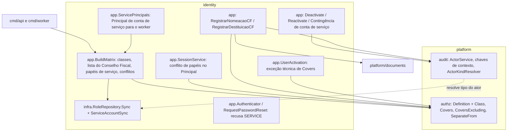
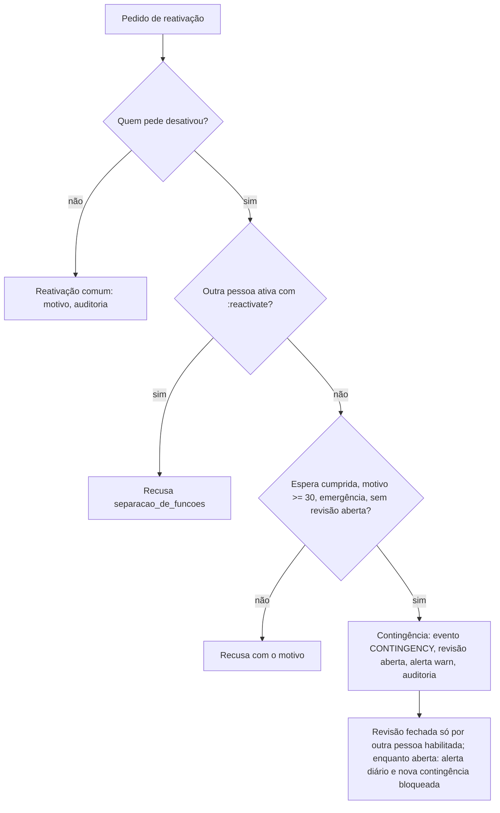

# Identity e governança — Design

**Spec**: `.specs/features/tj-connect/spec/02-identity-governanca.md` (aprovada em 2026-10-14)
**Status**: Draft — aguardando revisão do mantenedor. Nada aqui foi implementado; nenhuma migration foi criada.
**ADRs**: [013](../../../../docs/adr/013-contas-de-servico-e-autoria-de-processos.md), [016](../../../../docs/adr/016-permissoes-sensiveis-e-escopo-por-jogo.md), com [009](../../../../docs/adr/009-modelo-de-identidade-e-papeis-iniciais.md), [004](../../../../docs/adr/004-auditoria-e-imutabilidade-financeira.md), [006](../../../../docs/adr/006-armazenamento-de-documentos.md)
**Decisões do mantenedor**: D-02-1, D-02-2, D-02-3, D-02-4 (2026-10-14)

A escolha de abordagem (contas de serviço em `identity`, classes no catálogo, Conselho Fiscal por lista explícita) já foi feita e aprovada nas ADRs 013 e 016. Este documento detalha **como** implementá-la sobre o código atual.

---

## Conformidade com decisões ativas (`.specs/STATE.md`)

| Decisão | Como este design se conforma |
|---|---|
| AD-001 / AD-014 (monólito modular, `identity.New`, camadas) | Todo o novo código de identidade fica em `identity/{domain,app,infra,http}`; composição só em `identity/module.go` e nos `cmd/*` |
| AD-002 (GORM, `golang-migrate`, sem `AutoMigrate`) | Migrations `000010` e `000011` **propostas** aqui; SQL explícito como no `role_repository.go` atual |
| AD-004 (auditoria append-only na mesma transação) | Todo ato novo grava auditoria pelo `audit.Recorder` dentro do `WithTx`; nada muda nas linhas antigas |
| AD-005 / AD-011 (sessão, RBAC por permissão, `AdminMembership`) | Autorização continua só por permissão efetiva; `FISCAL` usa `AdminMembership`; papéis de serviço não usam |
| AD-010 / AD-012 (contrato OpenAPI primeiro) | Rotas novas listadas em "Contrato HTTP"; entram em `identity.yaml`/`platform.yaml` antes do código |
| AD-013 (negar por padrão) | Nenhuma rota pública nova neste grupo; todas na cadeia autenticada |
| AD-015 (`platform/documents` recebe a permissão do chamador) | A evidência do ato institucional usa `documents.Store` com `identity:conselho_fiscal:manage` passada por `identity` |

Nenhuma decisão ativa é substituída. As mudanças em ADR-009 e ADR-005 já estão previstas nas ADRs 013 e 016 (`Proposed`).

---

## Architecture Overview



A matriz agregada continua sendo construída uma vez por processo em `BuildMatrix` (falha de validação impede a partida) e sincronizada no banco por `RoleRepository.Sync`, agora também para classes, papéis de serviço e contas de serviço.

---

## Code Reuse Analysis

### Componentes existentes reaproveitados

| Componente | Local | Como é usado |
|---|---|---|
| `authz.Definition`, `Validate`, `NewAuthorizer` | `api/internal/platform/authz/permission.go`, `authz.go` | Ganham `Class` e `RequiresDecision`; `Validate` passa a exigir a classe |
| `authz.Covers` | `api/internal/platform/authz/escalation.go:10` | **Não muda.** Ganha uma variante `CoversExcluding`, de uso restrito por teste |
| `app.BuildMatrix`, `Contribution`, `FoundationContributions` | `api/internal/identity/app/roles_matrix.go` | Ponto único das regras de classe, lista do Conselho Fiscal e papéis de serviço |
| `domain.Role`, `AllRoles`, guarda "só `role.go` soletra papéis" | `api/internal/identity/domain/role.go`, `authz/rolename_guard_test.go` | `FISCAL` e os papéis de serviço entram aqui |
| `RoleRepository.Sync` (advisory lock, diff, `rbac.sync`) | `api/internal/identity/infra/role_repository.go:56` | Estendido para classes, tipo de papel e contas de serviço, na mesma transação e sob o mesmo lock |
| `SessionService.Validate` (permissões lidas a cada requisição) | `api/internal/identity/app/session_service.go:69` | Aplica a regra de conflito de papéis ao montar o `Principal` |
| `Authenticator.check`, `RequestPasswordReset` | `api/internal/identity/app/authenticate.go`, `request_password_reset.go` | Tratam conta `SERVICE` como inexistente/inativa (mesma resposta) |
| `AdminMembership`, `PromoteToAdmin`, `AssignRoles`, `RevokeAdmin`, `UserActivation` | `api/internal/identity/app/*.go` | Ganham os desvios definidos (nomeação do Conselho Fiscal, exceção técnica, recusa a conta de serviço) |
| `audit.Recorder`, `Entry.Validate`, `Register` | `api/internal/platform/audit/*.go` | Ganham `ActorService`, validação do tipo do ator e as chaves de contexto padronizadas |
| `audit.Query.Search` | `api/internal/platform/audit/query.go:122` | Ganha filtro por `correlation_id` |
| `platform/documents.Service.Store` | `api/internal/platform/documents/` | Guarda a ata do ato institucional (AD-015) |
| Testes de migration por arquivo, testcontainers | `api/internal/platform/database/*_migration_test.go`, `platform/testutil/postgres.go` | Mesmo padrão para `000010` e `000011` |

### Pontos de integração

| Sistema | Integração |
|---|---|
| `financeiro.Contribution()`, `estoque.Contribution()` | Passam a declarar `Class` em cada `Definition` e as concessões explícitas ao `PRESIDENTE` (`financeiro/module.go:119`, `estoque/module.go:78`) |
| `cmd/api/main.go:50` e `cmd/bootstrap-admin` | Mesma lista de contribuições; acrescentam a do pseudo-módulo `jobs` (design `01`) |
| `cmd/worker` (design `01`) | Usa `identity.ServicePrincipals` para obter o `Principal` de cada conta de serviço |
| Banco | Colunas e tabelas novas aditivas em `users`, `roles`, `permissions`, `sessions`, `user_roles`, `admin_memberships`, `audit_log` |

---

## Components

### C1 — `authz`: classe, `CoversExcluding` e separação de funções

- **Purpose**: dar à plataforma a classificação obrigatória e as duas primitivas de governança, sem decidir nada de negócio.
- **Location**: `api/internal/platform/authz/permission.go`, `escalation.go`, novo `sod.go`
- **Interfaces**:
  - `type Class string` com `ClassNormal = "normal"`, `ClassSensivel = "sensivel"`, `ClassPropria = "propria"`, `ClassServico = "servico"`.
  - `Definition{Permission; Description; CommonRead bool; Class Class; RequiresDecision bool}` — `Validate()` recusa classe vazia ou desconhecida, `RequiresDecision` fora de `servico` e `CommonRead` fora de `normal` (CLS-01 AC1, AC8; SOD-01 AC9).
  - `Covers(p, needed) []Permission` — **sem mudança**.
  - `CoversExcluding(p Principal, needed, excluded []Permission) []Permission` — igual a `Covers`, ignorando `excluded`. **`Covers` não muda**: continua sendo usado por todos os casos de uso atuais (`assign_roles.go:87`, `promote_admin.go:78`, `revoke_admin.go:74`, `deactivate_user.go:88`, `admin_reset_password.go:75`). Um teste de código-fonte garante que `CoversExcluding` só aparece em `identity/app/conselho_fiscal_acts.go` (nomeação e destituição) e `identity/app/deactivate_user.go` (bloqueio técnico de conselheiro), e sempre com o argumento `excluded` igual à constante `InstitutionalPermissions`, nunca com lista montada na hora (INS-01 AC7).
  - `ErrSeparationOfDuties = errors.New("separacao_de_funcoes")`, `ErrSelfAct = errors.New("ato_sobre_si_mesmo")`.
  - `SeparateFrom(actorID string, priorAuthors ...string) error` — `ErrSeparationOfDuties` se `actorID` está entre os autores (SOD-01 AC1). Compara **identidade de usuário**, nunca papel (INS-01 AC10).
- **Dependencies**: nenhuma nova.
- **Reuses**: o pacote atual; `Principal` não muda.

### C2 — Matriz: classes, lista do Conselho Fiscal, papéis de serviço e conflitos

- **Purpose**: concentrar em `BuildMatrix` todas as regras fail-closed da partida.
- **Location**: `identity/app/roles_matrix.go` (alterado), novos `identity/app/conselho_fiscal.go`, `identity/domain/role_conflicts.go`
- **Interfaces**:
  - `Contribution{Module; Permissions []authz.Definition; Grants map[Role][]Permission; ServiceAccounts []ServiceAccountDef}`.
  - `ServiceAccountDef{Name, Description string; Role domain.Role}` — `Name` no formato `svc.<modulo>-<processo>`, com o prefixo igual a `Module` (SVC-01 AC2).
  - `BuildMatrix(...)` passa a validar, nesta ordem, e falhar com mensagem que nomeia módulo e permissão:
    1. definição válida com classe (CLS-01 AC1–2);
    2. concessão `servico` a papel humano, ou não `servico` a papel de serviço (AC5–6);
    3. concessão `sensivel`/`servico` a `ASSOCIADO` (AC7);
    4. concessão ao `CONSELHO_FISCAL` fora de `conselhoFiscalAllowlist` ou com ação inválida, ou de classe `servico` (CFS-01 AC2–4);
    5. papel de serviço com mais de uma conta, ou conta sem papel de serviço (SVC-01 AC10).
  - Concessão automática ao `PRESIDENTE` muda de "todo o catálogo" (`roles_matrix.go:85-87`) para "todo `normal` e `propria`" (CLS-01 AC3). As `sensivel` só chegam por `Grants` explícito.
  - `conselhoFiscalAllowlist` — lista versionada das 11 permissões (CFS-01). Substitui `forbiddenToConselhoFiscal` (`roles_matrix.go:28`), que vira só a segunda barreira de ação.
  - `InstitutionalPermissions = []Permission{"financeiro:prestacao_contas:approve", "financeiro:parecer:opine"}` (INS-01 AC1).
  - `domain.IncompatiblePairs = [][2]Role{{RolePresidente, RoleConselhoFiscal}}` e `domain.Conflicts(roles []Role) [][2]Role` (INS-01 AC8, AC11).
  - `Matrix` ganha `Classes map[Permission]Class`, `ServiceRoles map[Role]ServiceAccountDef`.
- **Dependencies**: C1.
- **Reuses**: `BuildMatrix`, `belongsTo`, `Matrix.PermissionsOf`.

### C3 — Papéis

- **Purpose**: declarar `FISCAL` e os papéis de serviço no único arquivo autorizado.
- **Location**: `identity/domain/role.go`
- **Interfaces**:
  - `RoleFiscal Role = "FISCAL"` em `AllRoles`, descrição "Verificação de credenciais em jogo designado".
  - `type RoleKind string` (`HUMAN`, `SERVICE`) e `Role.Kind()`. Papéis de serviço com prefixo `SERVICO_`, declarados no mesmo arquivo. Neste grupo existe **um**: `SERVICO_JOBS_MANUTENCAO` (conta `svc.jobs-manutencao`, usada pelos jobs de manutenção da plataforma no design `01`), sem nenhuma permissão. As specs `04`+ acrescentam os seus.
  - `CheckRolesHaveMembership` (`admin_membership.go:79`) passa a ignorar papéis `SERVICE` e a recusá-los para conta humana.
- **Reuses**: guarda de nomes de papel existente (`authz/rolename_guard_test.go`).

### C4 — Contas de serviço

- **Purpose**: contas identificáveis, não interativas, com privilégio mínimo e chave de emergência (SVC-01).
- **Location**: novos `identity/domain/service_account.go`, `identity/infra/service_account_repository.go`, `identity/app/service_accounts.go`, `identity/app/service_principals.go`
- **Interfaces**:
  - Sincronização: `ServiceAccountRepository.Sync(ctx, defs []ServiceAccountDef)` chamada **dentro** de `RoleRepository.Sync`, sob o mesmo `pg_advisory_xact_lock` (`role_repository.go:60`). Cria contas ausentes (`users` com `kind='SERVICE'`, `email = <nome>@service.invalid`, `password_hash = '!servico'`, que não é um hash Argon2 válido e nunca verifica), atribui o papel de serviço, desativa (nunca exclui) contas removidas do código com origem `SYNC`, e não reativa conta desativada (SVC-01 AC3–5). Audita com `service_account.sync` (ator `system`, parte da sincronização).
  - `DeactivateServiceAccount.Execute(ctx, {Actor, Name, Reason})` — `identity:service_account:deactivate`, motivo ≥ 10 (AC11–12).
  - `ReactivateServiceAccount.Execute(ctx, {Actor, Name, Reason, Emergency string})` — `identity:service_account:reactivate`:
    - caminho comum: `authz.SeparateFrom(actor, ultimoDesativador)` (AC16–17);
    - caminho de contingência, só quando o caso de uso confirma, sob lock, que **nenhuma outra pessoa ativa** tem `:reactivate`: exige espera configurável desde a desativação (`IDENTITY_CONTINGENCY_WAIT`, padrão 30 min), motivo ≥ 30, identificação da emergência e nenhuma revisão de contingência aberta pela mesma pessoa (AC18, AC21). Grava o evento marcado `contingencia`, abre a revisão independente, registra auditoria e log `warn` (AC19);
    - recusa conta desativada pela sincronização (AC22).
  - `CloseContingencyReview.Execute(ctx, {Actor, ReviewID, Note})` — exige `:reactivate` ou `:deactivate` e `SeparateFrom(actor, reativador)` (AC20). Se a única pessoa habilitada é quem reativou, a revisão **fica aberta**: alerta diário (job de manutenção do design `01`), visível na listagem e na auditoria (lida pelo Conselho Fiscal), e bloqueia novas contingências dessa pessoa até existir outra pessoa habilitada que a feche. Nunca há autoaprovação.
  - `ListServiceAccounts` — `identity:service_account:read`; nunca devolve campo de credencial (AC15).
  - `ServicePrincipals.For(ctx, name) (authz.Principal, active bool, err)` — monta o `Principal` com `Matrix.PermissionsOf([papel de serviço])` e lê `users.is_active` a cada chamada. Usado pelo worker antes de cada job (design `01`, SVX-01).
- **Recusa por conta de serviço** em `PromoteToAdmin`, `AssignRoles`, `RevokeAdmin`, `AdminResetPassword`, `UserActivation`: `ErrServiceAccount` → 403 `forbidden` auditado como `role.change_denied`/`authz.denied` (AC9). `ListUsers` filtra `kind='HUMAN'` (AC14).
- **Reuses**: `users`, `user_roles`, `RoleRepository`, `ensureAdminRemains` (padrão de lock do conjunto administrativo para a verificação "outra pessoa habilitada").

### C5 — Login, sessão e recuperação

- **Purpose**: garantir que conta de serviço nunca obtenha sessão, por nenhum caminho (SVC-01 AC6–8).
- **Location**: `identity/app/authenticate.go`, `request_password_reset.go`, `identity/infra/user_repository.go`, migration `000010`
- **Mudanças**:
  - `domain.User` ganha `Kind`. `Authenticator.check` trata `Kind != HUMAN` exatamente como usuário inativo: mesma `ErrInvalidCredentials`, mesmo trabalho (`BurnCycles`).
  - `RequestPasswordReset` responde como para qualquer endereço e não cria token.
  - **Banco**: gatilho `sessions_require_human_user` (BEFORE INSERT em `sessions`) recusa `user_id` de conta `SERVICE` (AC8). Gatilho `user_roles_kind_consistency` recusa papel `SERVICE` a pessoa e papel humano a conta de serviço. Gatilho `admin_memberships_require_human` recusa vínculo administrativo a conta de serviço.
- **Reuses**: o padrão de resposta uniforme já existente no login.

### C6 — Auditoria: autoria e causalidade

- **Purpose**: autoria identificável para pessoa e processo, e rastreio do fluxo (AUT-01).
- **Location**: `platform/audit/entry.go`, `recorder.go`, `query.go`, `http.go`; migration `000011`
- **Interfaces**:
  - `ActorService ActorType = "service"`; `Validate` exige UUID para `user` e `service` (AC1–2).
  - Chaves padronizadas de `Context`: `audit.CtxCorrelationID = "correlation_id"`, `CtxCausationID`, `CtxOnBehalfOf = "on_behalf_of_user_id"`, `CtxDecisionID`, `CtxRule = "regra"`.
  - `type ActorKindResolver interface { KindOf(ctx, userID string) (string, error) }` — injetado no `Recorder` na composição (`audit.NewRecorder(db, log).WithActorKinds(identityUsers)`), porque `platform` não importa `identity`. Antes do `INSERT`, o recorder confere que `user` aponta para `HUMAN` e `service` para `SERVICE`, na mesma transação (AC3–4). **Não** é gatilho de banco: o `audit_log` evita deliberadamente restrições que impeçam a gravação de auditoria (comentário em `000002_audit_log.up.sql`).
  - Para `actor_type = service`, `Validate` exige `correlation_id` e `causation_id` no contexto (AC6); quando a ação declara execução de decisão, `decision_id`; quando é regra aprovada, `regra` (AC7, AC10).
  - `Filter.CorrelationID *string` em `Query.Search`, com índice de expressão (AC9).
  - **Teste de código-fonte**: `ActorSystem` só pode aparecer nos arquivos de bootstrap e de sincronização do RBAC (ações `user.bootstrap`, `rbac.sync`, `rbac.role_conflict`, `service_account.sync`) (AC5).
- **Reuses**: `Recorder.Record`/`RecordSecurity`, `Entry.Redacted`, `Query`.

### C7 — Nomeação e destituição institucional do Conselho Fiscal (D-02-4)

- **Purpose**: registrar o ato da instância competente, sem dar ao registrador poderes do Conselho e sem enfraquecer `Covers` (INS-01).
- **Location**: novos `identity/domain/institutional_act.go`, `identity/app/conselho_fiscal_acts.go`, `identity/infra/institutional_act_repository.go`
- **Interfaces**:
  - `RegisterCFAppointment.Execute(ctx, {Actor, TargetID, Body, ActReference, ActDate, DocumentID, Reason})` e `RegisterCFRemoval.Execute(...)`.
  - Regras, nesta ordem:
    1. `Require(identity:conselho_fiscal:manage)`;
    2. `ActReference`, `ActDate`, `Body` obrigatórios; `DocumentID` precisa existir em `documents` com `owner_type = "identity.ato_institucional"` (evidência verificável armazenada, D-02-4 limite 2);
    3. `SeparateFrom(actor, target)` e recusa se o ator tem `CONSELHO_FISCAL` (INS-01 AC4);
    4. na nomeação: recusa se o alvo tem `PRESIDENTE` (AC8); exige `AdminMembership` do alvo (cria o vínculo com o motivo, como `PromoteToAdmin`);
    5. `CoversExcluding(actor, PermissionsOf([CONSELHO_FISCAL]), InstitutionalPermissions)` (AC2);
    6. na mesma transação: grava `institutional_acts`, altera `user_roles`, revoga sessões do alvo, audita `cf.appointment_registered`/`cf.removal_registered` com o id do ato.
  - O ato é registrado como **ato externo** (campos `body`, `act_reference`, `act_date`, documento), nunca como decisão do registrador (AC3).
  - `AssignRoles`, `PromoteToAdmin` e `RevokeAdmin` passam a **recusar** qualquer alteração que inclua `CONSELHO_FISCAL`, com `ErrInstitutionalActRequired`, apontando para o caso de uso próprio. Isso fecha o desvio pelo caminho comum.
  - **Exceção técnica** (AC5): `UserActivation.change` (`deactivate_user.go:88`) usa `CoversExcluding(..., InstitutionalPermissions)` **somente** quando o alvo tem `CONSELHO_FISCAL`, mantendo `identity:user:update`. Bloquear ou desbloquear a conta não transfere nenhum poder ao ator.
  - **Sem exceção** (AC6): `AdminResetPassword` (`admin_reset_password.go:75`) mantém `Covers` integral, porque entrega a senha temporária ao ator (`admin_reset_password.go:46`). Isso permitiria entrar como conselheiro. A recuperação de acesso do conselheiro é só o autoatendimento por e-mail.
- **Reuses**: `PromoteToAdmin` (vínculo e revogação de sessões), `documents.Store`, `denyRoleChange`.

### C8 — Conflito de papéis no `Principal`

- **Purpose**: impedir que a união de papéis devolva ao `PRESIDENTE` as permissões institucionais, e tratar usuários já irregulares (INS-01 AC9).
- **Location**: `identity/app/session_service.go:97-114`; `identity/infra/role_repository.go` (relatório na sincronização)
- **Comportamento**:
  - **Verificação a cada autorização, não só no login.** `SessionService.Validate` roda **a cada requisição** autenticada e lê papéis e permissões do banco sem cache (`session_service.go:66-69`, `97-104`). Depois de `EffectivePermissions` e `RolesOf`, se `domain.Conflicts(roles)` não for vazio, **remove** do `Principal` daquela requisição as `InstitutionalPermissions`. Todo ato institucional desse usuário é negado por `Require` e auditado como `authz.denied`. Os demais acessos continuam (D-02-4 limite 6: bloquear só os atos incompatíveis). Um papel atribuído ou retirado vale na requisição seguinte.
  - **Na atribuição de papéis**: `AssignRoles`, `PromoteToAdmin` e os casos de uso de C7 calculam os papéis **resultantes** do alvo e recusam com `papeis_incompativeis` se `domain.Conflicts` não for vazio (INS-01 AC8), dentro da transação, depois de reler os papéis atuais.
  - **Nos atos institucionais**: `RegisterCFAppointment` e `RegisterCFRemoval` revalidam, dentro da transação e com os papéis relidos, que o ator não tem `CONSELHO_FISCAL` e não está em conflito, e que o alvo não tem `PRESIDENTE` (INS-01 AC4, AC8). Nada depende de estado guardado na sessão.
  - A cada sincronização, `RoleRepository` lista os usuários em conflito e grava `rbac.role_conflict` (ator `system`, parte da sincronização) com os ids, sem revogar nada. Os registros históricos não mudam.
  - `ListUsers` marca `irregularidade: conflito_de_papeis` para a administração.
  - A regularização é remover um dos papéis pelos casos de uso normais (`RegisterCFRemoval` ou `RevokeAdmin`/`AssignRoles` para o `PRESIDENTE`).

### C9 — Registro de decisão e execução por regra (contrato para os módulos)

- **Purpose**: fixar o contrato que as specs `04`–`14` implementam (SOD-01), sem tabela genérica na plataforma.
- **Location**: documentação em `platform/authz/sod.go` e neste design. Cada módulo dono tem a sua tabela de decisões.
- **Contrato**:
  - Colunas mínimas de toda tabela de decisão: `id`, `escopo` (tipo e id do alvo, valor quando houver), `decidido_por`, `motivo` (≥ 10), `estado` (`APROVADA`, `EXECUTADA`, `REVOGADA`), `decidido_em`, `executado_em`, `executado_por`.
  - Execução: `UPDATE ... SET estado='EXECUTADA' WHERE id=$1 AND estado='APROVADA' AND <escopo confere>`, na transação do efeito; zero linhas = recusa auditada (SOD-01 AC5–7).
  - Execução por regra aprovada (permissão `servico` sem `RequiresDecision`): não toca tabela de decisão; a auditoria leva `regra` = `"<modulo>.<regra>@v<n>"` (SOD-01 AC10).
  - A primeira implementação real do contrato é a revisão de contingência (C4) e o ato institucional (C7).

---

## Data Models — migrations propostas (não criadas)

### `000010_identity_governanca` (dona: `identity`; roda com `tj_owner`)

```sql
-- users: tipo de conta; todas as contas atuais passam a HUMAN (TRN-01 AC6).
ALTER TABLE users ADD COLUMN kind text NOT NULL DEFAULT 'HUMAN'
  CHECK (kind IN ('HUMAN', 'SERVICE'));

-- roles e permissions: metadados sincronizados do código.
ALTER TABLE roles ADD COLUMN kind text NOT NULL DEFAULT 'HUMAN' CHECK (kind IN ('HUMAN', 'SERVICE'));
ALTER TABLE permissions ADD COLUMN class text NOT NULL DEFAULT 'normal'
  CHECK (class IN ('normal', 'sensivel', 'propria', 'servico'));
ALTER TABLE permissions ADD COLUMN requires_decision boolean NOT NULL DEFAULT false;

-- Contas de serviço: identidade estável e origem da desativação.
CREATE TABLE service_accounts (
  user_id      uuid PRIMARY KEY REFERENCES users (id),
  name         text NOT NULL UNIQUE CHECK (name ~ '^svc\.[a-z_]+-[a-z_]+$'),
  module       text NOT NULL,
  description  text NOT NULL,
  created_at   timestamptz NOT NULL DEFAULT now()
);

-- Histórico append-only de desativação e reativação.
CREATE TABLE service_account_events (
  id            uuid PRIMARY KEY DEFAULT gen_random_uuid(),
  user_id       uuid NOT NULL REFERENCES service_accounts (user_id),
  kind          text NOT NULL CHECK (kind IN ('DEACTIVATED', 'REACTIVATED')),
  origin        text NOT NULL CHECK (origin IN ('MANUAL', 'SYNC', 'CONTINGENCY')),
  actor_user_id uuid REFERENCES users (id),          -- nulo só para origin = SYNC
  reason        text NOT NULL,
  emergency     text,                                -- obrigatório em CONTINGENCY
  occurred_at   timestamptz NOT NULL DEFAULT now(),
  CHECK ((origin = 'SYNC') = (actor_user_id IS NULL)),
  CHECK (origin <> 'CONTINGENCY' OR (emergency IS NOT NULL AND length(btrim(reason)) >= 30))
);

-- Revisão independente das reativações de contingência.
CREATE TABLE service_account_contingency_reviews (
  id           uuid PRIMARY KEY DEFAULT gen_random_uuid(),
  event_id     uuid NOT NULL UNIQUE REFERENCES service_account_events (id),
  opened_by    uuid NOT NULL REFERENCES users (id),
  opened_at    timestamptz NOT NULL DEFAULT now(),
  closed_by    uuid REFERENCES users (id),
  closed_at    timestamptz,
  note         text,
  CHECK (closed_by IS NULL OR closed_by <> opened_by),
  CHECK ((closed_by IS NULL) = (closed_at IS NULL))
);
CREATE INDEX service_account_contingency_open_idx
  ON service_account_contingency_reviews (opened_by) WHERE closed_at IS NULL;

-- Atos institucionais (nomeação e destituição do Conselho Fiscal): append-only.
CREATE TABLE institutional_acts (
  id             uuid PRIMARY KEY DEFAULT gen_random_uuid(),
  kind           text NOT NULL CHECK (kind IN ('CF_APPOINTMENT', 'CF_REMOVAL')),
  target_user_id uuid NOT NULL REFERENCES users (id),
  body           text NOT NULL,          -- instância competente (ex.: Assembleia Geral)
  act_reference  text NOT NULL,          -- identificação do ato (ex.: ata e número)
  act_date       date NOT NULL,
  document_id    uuid NOT NULL REFERENCES documents (id),
  reason         text NOT NULL CHECK (length(btrim(reason)) >= 10),
  registered_by  uuid NOT NULL REFERENCES users (id),
  registered_at  timestamptz NOT NULL DEFAULT now(),
  CHECK (registered_by <> target_user_id)
);

-- Guardas no banco (mesmo módulo, identity).
--   sessions_require_human_user      BEFORE INSERT ON sessions
--   user_roles_kind_consistency      BEFORE INSERT ON user_roles
--   admin_memberships_require_human  BEFORE INSERT ON admin_memberships

GRANT SELECT, INSERT ON service_accounts, service_account_events, institutional_acts TO tj_app;
GRANT SELECT, INSERT, UPDATE ON service_account_contingency_reviews TO tj_app;
```

### `000011_audit_service_actor` (dona: `platform`)

```sql
ALTER TABLE audit_log DROP CONSTRAINT audit_log_actor_type_check;
ALTER TABLE audit_log ADD CONSTRAINT audit_log_actor_type_check
  CHECK (actor_type IN ('user', 'service', 'system', 'anonymous'));
ALTER TABLE audit_log DROP CONSTRAINT audit_log_actor_consistent;
ALTER TABLE audit_log ADD CONSTRAINT audit_log_actor_consistent
  CHECK ((actor_type IN ('user', 'service')) = (actor_user_id IS NOT NULL));
CREATE INDEX audit_log_correlation_idx ON audit_log ((context ->> 'correlation_id'))
  WHERE context ? 'correlation_id';
```

O nome automático da restrição do `CHECK` inline (`audit_log_actor_type_check`) deve ser confirmado no banco antes de escrever a migration; o teste de migration verifica.

### Compatibilidade com a base atual (verificada em 2026-10-14, sem executar nada)

| Ponto | Verificação |
|---|---|
| `users`, `roles`, `permissions`, `sessions`, `user_roles`, `admin_memberships` (`000003`) | Só `ADD COLUMN ... NOT NULL DEFAULT` e gatilhos novos; nenhuma coluna existente muda. Todas as linhas atuais satisfazem os valores padrão (`HUMAN`, `normal`, `false`) e os gatilhos (só há contas humanas e papéis humanos) |
| Gatilhos de `identity` | Funções `SECURITY INVOKER` que fazem `SELECT` em `users` e `roles`, que o `tj_app` já pode ler (`000003`); nenhuma permissão nova necessária para os gatilhos |
| `institutional_acts.document_id → documents(id)` | `documents.id` é `uuid` (`000005`); `tj_app` tem `SELECT` em `documents` |
| `audit_log` (`000002`) | `ADD CONSTRAINT` valida as linhas existentes sem alterá-las (o gatilho de imutabilidade só reage a `UPDATE`/`DELETE`/`TRUNCATE`). As linhas atuais têm `user` com id e `system`/`anonymous` sem id, então satisfazem a nova restrição. A restrição nomeada `audit_log_actor_consistent` existe; a do `actor_type` é inline (nome automático) |
| `gen_random_uuid()` | Extensão `pgcrypto` já criada em `000001` |
| Guarda de schema (`schema_guard_test.go`) | Nenhuma coluna `real`, `numeric` ou `_cents` |
| Papéis do banco | Mesmo bloco `DO $$ ... tj_app ... $$` das migrations atuais, recusando rodar sem o papel `tj_app` |
| Numeração | `000010` e `000011` vêm logo depois da última existente (`000009_estoque_movimentacoes`) |

**Relacionamentos**: `service_accounts.user_id → users`; `institutional_acts.document_id → documents` (dono `platform`, leitura pela FK, como `lancamentos.criado_por → users`); nenhuma tabela de outro módulo é escrita.

---

## Matriz de permissões: antes e depois

Fonte do "antes": código atual (`FoundationContributions`, `financeiro.Contribution`, `estoque.Contribution`), com o `PRESIDENTE` recebendo todo o catálogo (`roles_matrix.go:85-87`).

| Papel | Antes | Depois do G1 | Onde muda no código |
|---|---|---|---|
| `PRESIDENTE` | 30 (automáticas) | **32**: 28 das 30 (12 `normal` automáticas + 16 `sensivel` explícitas com justificativa); +`identity:service_account:read` (automática); +`:deactivate`, +`:reactivate`, +`jobs:job:read` (explícitas, D-02-1/D-01-1). **33** se aprovada a concessão de `identity:conselho_fiscal:manage` (pendente, ver "Pendências") | `FoundationContributions` (6 de `identity`, novas), `financeiro.Contribution` (10), `estoque.Contribution` (2), contribuição `jobs` |
| `ADMIN_SISTEMA` | 8 | **13**: +`identity:service_account:read` (necessária para operar a D-02-1), `:deactivate`, `:reactivate`; +`jobs:job:read`, `jobs:job:retry` | `FoundationContributions`, contribuição `jobs` |
| `CONSELHO_FISCAL` | 11 | 11 (lista explícita) | `conselhoFiscalAllowlist` |
| `TESOURARIA` | 13 | 13 | Só a classe muda; concessão já explícita |
| `ESTOQUE_LOJA` | 6 | 6 | Idem |
| `DIRETORIA` | 8 | 8 | — |
| `ASSOCIADO`, `EVENTOS` | 0 | 0 | — |
| `FISCAL` | — | 0 | `role.go` |
| `SERVICO_JOBS_MANUTENCAO` | — | 0 | `role.go` |

**As 16 concessões explícitas de transição ao `PRESIDENTE`** (D-02-2), cada uma com a justificativa "preserva acesso atual do `PRESIDENTE`, anterior à classificação; não amplia":

- `identity`: `user:create`, `user:update`, `user:reset_password`, `role:assign`, `admin:grant`, `admin:revoke`;
- `financeiro`: `conta:create`, `conta:update`, `conta:deactivate`, `lancamento:create`, `lancamento:update`, `lancamento:receive`, `lancamento:pay`, `lancamento:cancel`;
- `estoque`: `movimentacao:create`, `movimentacao:adjust`.

A justificativa fica num comentário estruturado ao lado de cada concessão e numa tabela do teste de snapshot.

**Exceção aprovada (D-02-3)**: `financeiro:prestacao_contas:approve` e `financeiro:parecer:opine` deixam o `PRESIDENTE`. Hoje **nenhum caso de uso verifica essas duas permissões** (FIN-D-014), então a retirada não interrompe nenhuma função em uso. Ela é aplicada **no mesmo incremento** que C7 (INS-01), para não criar o bloqueio de `Covers` descrito na spec.

### Teste de snapshot (TRN-01, CFS-01)

- `identity/app/testdata/matriz_pre_classificacao.json`: gerado **uma vez** a partir do código atual, antes de qualquer mudança, e versionado.
- `identity/app/testdata/excecoes_aprovadas.json`: lista as diferenças autorizadas (`PRESIDENTE −approve`, `PRESIDENTE −opine`, com a referência D-02-3 e a data).
- O teste reconstrói a matriz com as contribuições reais e exige: para as 30 permissões existentes, `antes − exceções = depois`, papel a papel. Permissões novas são reportadas e conferidas contra a tabela "Depois do G1".
- O snapshot do Conselho Fiscal (11 permissões) é um teste à parte (CFS-01 AC6).

---

## Fluxos principais

### Nomeação de conselheiro (INS-01)

```mermaid
sequenceDiagram
  participant P as Pessoa com conselho_fiscal:manage
  participant API as identity/http
  participant UC as RegisterCFAppointment
  participant DOC as platform/documents
  participant DB as PostgreSQL
  P->>API: POST /documents (ata) com owner_type identity.ato_institucional
  API->>DOC: Store(principal, perm conselho_fiscal:manage)
  P->>API: POST /api/v1/conselho-fiscal/nomeacoes {alvo, instância, ato, data, documento, motivo}
  API->>UC: Execute
  UC->>UC: Require(manage); SeparateFrom; alvo sem PRESIDENTE; CoversExcluding
  UC->>DB: BEGIN; INSERT institutional_acts; vínculo admin; user_roles += CONSELHO_FISCAL; revoga sessões do alvo; audit cf.appointment_registered; COMMIT
```

### Reativação de conta de serviço



---

## Contrato HTTP (contract-first, AD-010/AD-012)

Todas na cadeia autenticada (sessão, CSRF, contrato). Nenhuma pública.

| Método e rota | Contrato | Caso de uso |
|---|---|---|
| `GET /api/v1/service-accounts` | `identity.yaml` | `ListServiceAccounts` |
| `POST /api/v1/service-accounts/{name}/deactivate` | `identity.yaml` | `DeactivateServiceAccount` |
| `POST /api/v1/service-accounts/{name}/reactivate` | `identity.yaml` | `ReactivateServiceAccount` (corpo com `emergency` opcional) |
| `POST /api/v1/service-accounts/contingency-reviews/{id}/close` | `identity.yaml` | `CloseContingencyReview` |
| `POST /api/v1/conselho-fiscal/nomeacoes` e `/destituicoes` | `identity.yaml` | C7 |
| `GET /api/v1/audit-logs?correlation_id=` | `platform.yaml` | `audit.Query` (parâmetro novo) |

Novos códigos de erro em problem+json: `separacao_de_funcoes` (403), `ato_sobre_si_mesmo` (403), `ato_institucional_obrigatorio` (422), `papeis_incompativeis` (409), `contingencia_indisponivel` (409, com o motivo: espera, revisão aberta, outra pessoa habilitada).

---

## Error Handling Strategy

| Cenário | Tratamento | O que o usuário vê |
|---|---|---|
| Classe ausente, concessão fora da regra, Conselho Fiscal fora da lista | `BuildMatrix` falha; API e worker não sobem | Nada (falha de implantação, mensagem nomeia módulo e permissão) |
| Login ou recuperação com e-mail de conta de serviço | Mesma resposta de credencial inválida / pedido aceito | Igual a qualquer credencial errada |
| Atribuição de papel a conta de serviço | `ErrServiceAccount` → 403, auditado | `forbidden` |
| Alteração que inclui `CONSELHO_FISCAL` pelo caminho comum | `ErrInstitutionalActRequired` → 422 | `ato_institucional_obrigatorio` |
| `PRESIDENTE` + `CONSELHO_FISCAL` na mesma pessoa | Atribuição recusada (409); se já existe, permissões institucionais retiradas do `Principal` | `papeis_incompativeis`; atos institucionais negados |
| Reativação pela mesma pessoa sem contingência válida | 403 ou 409 com o motivo | `separacao_de_funcoes` / `contingencia_indisponivel` |
| Entrada de auditoria com tipo de ator incoerente | `ErrInvalidEntry`; a transação de negócio falha | 500 `audit_failed` (erro de programação, não de uso) |

---

## Estratégia incremental e compatibilidade

Cada incremento é implantável sozinho, sem bloquear usuários atuais.

| # | Incremento | Efeito para usuários atuais | Requisitos |
|---|---|---|---|
| I-1 | `authz.Class` + classificação das 30 + 16 concessões explícitas + `BuildMatrix` fail-closed + teste de snapshot, **sem** aplicar a D-02-3 | **Nenhum**: matriz efetiva idêntica (snapshot com zero exceções nesta etapa) | CLS-01, TRN-01 (AC1–5) |
| I-2 | Lista explícita do Conselho Fiscal | Nenhum: as 11 permissões continuam | CFS-01 |
| I-3 | Migration `000010` + `kind` + guardas de login, sessão e recuperação + papel `FISCAL` + contas de serviço e sincronização + C4 | Nenhum: todas as contas viram `HUMAN`; `FISCAL` sem permissões | SVC-01, FIS-01, TRN-01 (AC6) |
| I-4 | Migration `000011` + autoria `service`, chaves de contexto, resolvedor de tipo, filtro por `correlation_id`, guarda de `system` | Nenhum: entradas antigas intocadas; `system` só onde já é usado | AUT-01, TRN-01 (AC7) |
| I-5 | `SeparateFrom`, contrato de decisão (C9) | Nenhum | SOD-01 |
| I-6 | **D-02-3 + D-02-4 juntos**: C7, C8, exceções fechadas de `Covers`, retirada das duas permissões do `PRESIDENTE`, snapshot com a exceção aprovada | `PRESIDENTE` perde 2 permissões que **nenhum caso de uso usa hoje**; atribuir `CONSELHO_FISCAL` passa a exigir o caso de uso institucional; usuário com os dois papéis perde só os atos institucionais | INS-01, TRN-01 (AC8) |

Condição para I-6: alguém precisa ter `identity:conselho_fiscal:manage` **no momento da implantação**, senão nomeações ficam impossíveis. Ver "Pendências".

### Rollback

| Item | Como reverter | Limite |
|---|---|---|
| I-1, I-2, I-5 | Reverter o código | Nenhum dado gravado |
| `000010` down | Remove gatilhos, tabelas e colunas novas | O `down` **recusa** (RAISE) se existir conta `SERVICE`, evento, revisão ou ato institucional. Dados de governança não são apagados; a correção passa a ser só para frente |
| `000011` down | Restaura as restrições antigas | **Recusa** se existir linha `actor_type = 'service'` no `audit_log` (append-only, imutável); depois disso, só para frente |
| I-6 | Reverter o código restaura a concessão automática | Os atos institucionais gravados permanecem (histórico) |

---

## Testes previstos

| Tipo | O quê | Spec |
|---|---|---|
| Unidade | `Definition.Validate` (classe, `RequiresDecision`, `CommonRead`); `BuildMatrix` com cada violação (T-01, T-02, T-03, T-17, T-18, T-21) | CLS-01, CFS-01, SOD-01 |
| Unidade (snapshot) | Matriz pré-classificação × atual, com exceções aprovadas (T-04, T-24); lista do Conselho Fiscal (T-19) | TRN-01, CFS-01 |
| Unidade | `SeparateFrom`, `CoversExcluding`, `domain.Conflicts`; usuário com dois papéis (T-10, T-27) | SOD-01, INS-01 |
| Código-fonte | `ActorSystem` só nos arquivos permitidos (T-14); `CoversExcluding` só nos dois arquivos permitidos (INS-01 AC7) | AUT-01, INS-01 |
| Integração (testcontainers) | Migrations `000010`/`000011`: up, down, grants, restrições, gatilhos, `down` recusado com dados (padrão `*_migration_test.go`) | TRN-01, SVC-01, AUT-01 |
| Integração | Login e recuperação de conta de serviço (T-06); `INSERT` de sessão recusado (T-07); sincronização de contas (T-08); `Principal` desativado (T-09); auditoria por `correlation_id` (T-15) | SVC-01, AUT-01 |
| Integração | Reativação comum, contingência com espera, revisão por outra pessoa, bloqueio enquanto aberta (T-22, T-23) | SVC-01 |
| Integração | Nomeação com documento e `manage`; recusa sem documento, alvo `PRESIDENTE`, ator conselheiro; caminho comum recusado (T-25, T-26) | INS-01 |
| Integração | Desativação técnica de conselheiro pelo `PRESIDENTE` aceita; `AdminResetPassword` de conselheiro recusado | INS-01 AC5–6 |
| Concorrência | Duas execuções da mesma decisão (T-12); duas reativações de contingência simultâneas; sincronização simultânea em duas instâncias | SOD-01, SVC-01 |
| Regressão | Suítes atuais de `identity`, `financeiro`, `estoque`, `httpapi` e o e2e passam sem alteração de comportamento depois de I-1 a I-5 | TRN-01 |

---

## Risks & Concerns

| Concern | Location | Impact | Mitigation |
|---|---|---|---|
| Concessão total ao `PRESIDENTE` está embutida em `BuildMatrix` | `identity/app/roles_matrix.go:85-87` | Mudar a regra sem snapshot poderia retirar acesso | I-1 só muda com o teste de snapshot verde e zero exceções |
| `forbiddenToConselhoFiscal` é lista de verbos | `identity/app/roles_matrix.go:28` | Verbo ou leitura nova passaria | Lista explícita (C2) + verbos como segunda barreira |
| `audit_log` sem FK por desenho | `api/migrations/000002_audit_log.up.sql` | Coerência do tipo do ator não pode ser restrição de banco | Verificação no `Recorder` com `ActorKindResolver` (C6) + teste |
| `AdminResetPassword` devolve a senha temporária ao ator | `identity/app/admin_reset_password.go:46` | Uma exceção de `Covers` permitiria entrar como conselheiro | Sem exceção (INS-01 AC6); recuperação só por e-mail |
| Provedor de e-mail atual é `log`/`disabled` | `platform/email/email.go` | Conselheiro sem senha não recupera acesso em produção | Provedor real já é pré-requisito de produção (STATE); registrado como dependência de I-6 |
| Nome do `CHECK` inline do `audit_log` gerado automaticamente | `000002_audit_log.up.sql` | `DROP CONSTRAINT` com nome errado falha a migration | Confirmar o nome real e cobrir no teste de migration |
| Dois processos (API e worker) sincronizando a matriz | `role_repository.go:60` | Corrida na sincronização | O advisory lock já serializa; a extensão usa o mesmo lock |
| `ListUsers` hoje lista todas as contas | `identity/app/list_users.go` | Contas de serviço apareceriam na administração | Filtro `kind='HUMAN'` (SVC-01 AC14) |
| Testes atuais montam `authz.Definition` sem classe e esperam a concessão total ao `PRESIDENTE` | `identity/app/roles_matrix_test.go:81`, `identity/infra/role_repository_test.go:416`, `financeiro/module_test.go:15` | Ficam vermelhos em I-1 | Ajuste desses testes faz parte de I-1, com o teste de snapshot provando que o comportamento efetivo não mudou |
| Teste atual espera que promover a `CONSELHO_FISCAL` sem a permissão falhe por `Covers` | `identity/app/promote_admin_test.go:170` | Em I-6 o caminho comum passa a recusar com `ato_institucional_obrigatorio` | Teste reescrito em I-6 para o novo motivo, mais os testes de INS-01 |
| Verificação de que nenhum uso das permissões retiradas existe | busca em `api/` e `web/` (2026-10-14): só declarações e testes | — | Confirma que a D-02-3 não interrompe função em uso (FIN-D-014) |

---

## Tech Decisions

| Decisão | Escolha | Motivo |
|---|---|---|
| Onde verificar o tipo do ator da auditoria | No `Recorder`, com interface injetada | `audit_log` não pode ter restrição que impeça a gravação; `platform` não importa `identity` |
| Exceção de `Covers` | Função separada `CoversExcluding`, uso restrito por teste a dois arquivos | Limita a exceção às operações expressamente definidas (D-02-4 limite 3) sem alterar `Covers` |
| Conflito de papéis | Calculado ao montar o `Principal` (sem tabela) | Sempre atual, sem estado a manter; bloqueia só os atos incompatíveis |
| Evidência do ato institucional | Documento obrigatório em `platform/documents` | "Referência verificável" (D-02-4 limite 2); reaproveita o armazenamento já obrigatório na API |
| Senha de conta de serviço | Valor `'!servico'` em `password_hash` | Coluna é `NOT NULL`; o valor não é um hash Argon2 válido, então `Verify` falha sempre, além da recusa explícita por `kind` |
| Papéis de serviço | Declarados em `role.go` com prefixo `SERVICO_` | Mantém a regra "um único arquivo soletra papéis" |

---

## Rastreabilidade

| Requisito | Componentes | ADR / decisão |
|---|---|---|
| CLS-01 | C1, C2 | ADR-016 |
| TRN-01 | C2, snapshot, I-1/I-6 | D-02-2, D-02-3 |
| SVC-01 | C3, C4, C5, migration `000010` | ADR-013, D-02-1 |
| SOD-01 | C1 (`SeparateFrom`), C9 | ADR-013, ADR-016 |
| AUT-01 | C6, migration `000011` | ADR-013 |
| FIS-01 | C3 (`FISCAL`), consulta de elegibilidade em `identity/app` | ADR-016 |
| CFS-01 | C2 (lista explícita), snapshot | ADR-016, parecer externo |
| INS-01 | C1 (`CoversExcluding`), C7, C8 | D-02-3, D-02-4 |

---

## Pendências

**Bloqueiam o Design: nenhuma.**

**Bloqueiam só a implantação de I-6** (não as Tasks):

- **Quem recebe `identity:conselho_fiscal:manage`**. Sem nenhuma concessão, a D-02-3 tornaria impossível nomear ou destituir conselheiros. Recomendação: `PRESIDENTE`, por concessão explícita, coerente com "registrar o ato da instância competente" (D-02-4 limite 2).
- **Provedor de e-mail real** em produção, para a recuperação de acesso dos conselheiros.

**Não bloqueiam**: lista adicional de papéis incompatíveis (só por regra do estatuto, D-02-4 limite 7).
