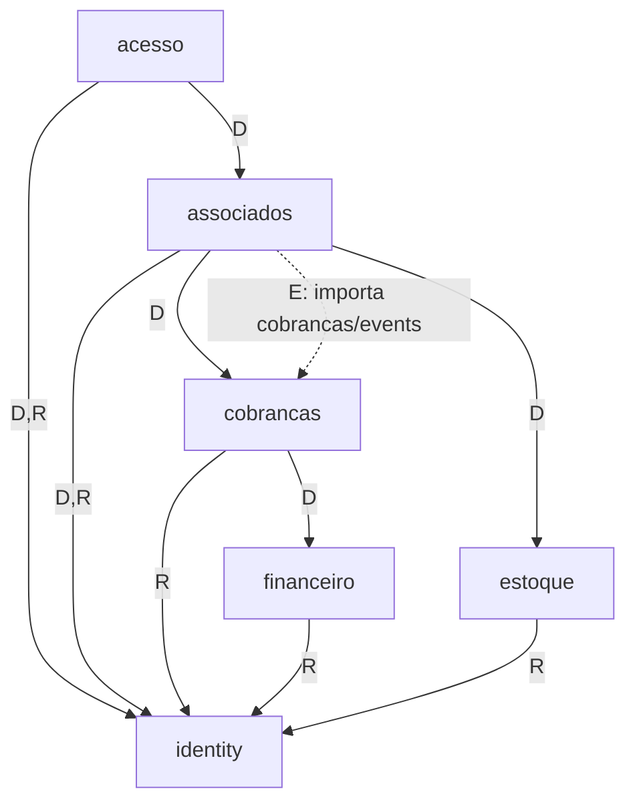

# ADR-011: Mapa de módulos e dependências do TJ Connect

- **Date**: 2026-10-13 (revisão 2, decisões M-1 a M-9); 2026-10-14 (revisão 3: nomes de eventos alinhados à ADR-012)
- **Status**: Proposed. Aprovado conceitualmente; ainda não aceito; não autoriza implementação.
- **Deciders**: @antoniobt12062002
- **Tags**: architecture, modules, tj-connect

## Context and Problem Statement

O TJ Connect 2027 (`docs/tj-connect/03-tj-connect-requisitos.md`) amplia a plataforma com:

- cadastro público;
- adesão anual paga e quota de ingresso;
- cobrança pelo Mercado Pago;
- jogos, check-in, frequência e suspensão;
- camisetas sob encomenda.

A [ADR-001](001-adotar-monolito-modular.md) previu `associados`, `acesso`, `eventos` e `loja`, mas não um módulo de cobranças. O grafo de [domain-boundaries](../architecture/domain-boundaries.md) foi desenhado antes desses fluxos, mistura setas **permitidas** com setas **existentes** e não distingue chamada direta de comunicação por evento. É preciso fixar:

- quem é dono de cada dado;
- o grafo **real** de dependências, separado por tipo;
- a prova de ausência de ciclos;
- o que o teste arquitetural passa a verificar.

## Decision Drivers

- Só o módulo dono altera seus dados; comunicação por interface publicada.
- Sem dependência circular (regra 4 de domain-boundaries), hoje verificada só em revisão.
- Uma transação por caso de uso; `database.WithTx` faz a chamada direta a outro módulo entrar na transação aberta.
- Financeiro e Estoque existentes não são duplicados (TJ-FIN-001, TJ-EST-001).
- `cobrancas` deve ser reutilizável pela loja sem que o TJ Connect antecipe funcionalidade comercial (D1).

## Considered Options

1. **Seis módulos com donos separados**; a confirmação de pagamento é comunicada por evento persistente.
2. **Tudo associativo em `associados`**, inclusive cobrança, jogos e check-in.
3. **Cobrança dentro de `associados`**, extraída depois.
4. **Jogos em `eventos`.**

## Decision Outcome

Chosen option: **1**. É a única em que cada invariante crítico (quota, cobrança, check-in) tem um dono só e o grafo de compilação continua acíclico.

### Responsabilidades

| Módulo | É dono de | Não é dono de |
|---|---|---|
| `identity` | Contas humanas e de serviço ([ADR-013](013-contas-de-servico-e-autoria-de-processos.md)), credenciais, verificação de e-mail, sessões, papéis, catálogo e classificação de permissões ([ADR-016](016-permissoes-sensiveis-e-escopo-por-jogo.md)) | Qualquer dado associativo; não sabe se alguém é associado pagante |
| `associados` | Temporada, plano por temporada, **liberação comercial** (M-5), quota e reservas, perfil associativo (CPF, número permanente, M-8), adesões e seu histórico (M-6), foto e habilitação do benefício, carteirinha, cancelamento, encomendas e lotes de camiseta | Estado do pagamento no provedor; lançamentos; saldo físico |
| `cobrancas` | Cobrança, order e pagamentos no provedor, notificações recebidas, reembolsos, contestações, conciliação e divergências | Motivo de negócio da cobrança: guarda só o par opaco `originador_tipo` + `originador_id` |
| `acesso` | Jogos e elegibilidade, intenção de comparecimento, relatório agregado ao clube, designação de fiscais, credencial/QR, tentativas e check-ins, correções, fatos e apuração de frequência, procedimento e suspensão | Adesão, plano, foto (lidos de `associados`) |
| `financeiro` | Lançamentos e contas (sem mudança de dono) | Cobrança e adesão |
| `estoque` | SKU e movimentações físicas (sem mudança de dono) | Encomenda, nome personalizado, titular |

A suspensão fica em `acesso` porque restringe só o benefício de ingresso (TJ-JOG-005), e a apuração de frequência precisa dos check-ins. Em `associados`, as duas obrigariam `associados` a ler `acesso`, criando um ciclo.

### Três tipos de relação entre módulos

| Tipo | O que é | Direção de compilação | Transação |
|---|---|---|---|
| **D: chamada direta** | O caso de uso de A chama um caso de uso ou consulta publicada no pacote `app` de B | A importa `B/app` | A chamada entra na transação de A (`WithTx`) |
| **E: contrato de evento** | B publica tipos de evento versionados num pacote só de tipos (`B/events`); A se inscreve | A importa `B/events`; B **não** importa A | O evento é gravado na transação de B; A o consome noutra transação, pelo worker ([ADR-014](014-worker-e-processamento-persistente.md)) |
| **R: contribuição de RBAC** | O módulo declara permissões com o tipo `Contribution` | Módulo importa `identity/app` | Nenhuma (só na partida) |

A composição (`cmd/api`, `cmd/worker`) importa todos os módulos, mas não é um módulo e fica fora do grafo.

### Grafo real

**Hoje, no código** (verificado na `develop` em `e592c81`): `financeiro →R identity` e `estoque →R identity`. A seta `financeiro → estoque` de domain-boundaries é **permitida e não usada** (nenhum import).

**Proposto pelo TJ Connect** (cada seta com a finalidade):

| De | Para | Tipo | Finalidade |
|---|---|---|---|
| `associados`, `cobrancas`, `acesso` | `identity` | R | Declarar permissões |
| `associados` | `identity` | D | Consultar conta (e-mail confirmado, nome) para a adesão |
| `acesso` | `identity` | D | Validar que o fiscal designado tem conta ativa |
| `cobrancas` | `financeiro` | D | Registrar receita e devolução de cobrança, com idempotência ([ADR-017](017-evolucao-aditiva-de-financeiro-e-estoque.md)) |
| `associados` | `cobrancas` | D | `CriarCobranca`, `ConsultarCobranca`, `SolicitarReembolso` |
| `associados` | `cobrancas` | E | Consumir `cobranca.paga`, `nao_concluida`, `reembolso_concluido`, `contestada`, `contestacao_perdida`, `divergente` ([ADR-012](012-cobrancas-e-eventos-persistentes.md)) |
| `associados` | `estoque` | D | Recebimento de lote e entrega de camiseta (só referência opaca) |
| `acesso` | `associados` | D | Consultar elegibilidade (adesão ativa, plano com ingresso, foto habilitada, início do benefício, número) |

Não há evento de `associados` para `acesso`. O check-in sempre lê o estado atual da adesão na mesma transação ([ADR-018](018-invariantes-transacionais-de-quota-e-check-in.md)), e assim um cancelamento definitivo invalida a autorização na hora (TJ-ASSOC-003) sem propagação.

Setas sólidas e tracejadas apontam na **direção de compilação** (quem importa quem). Em tempo de execução, o evento flui de `cobrancas` para `associados` pela outbox.

### Demonstração de ausência de ciclos

**1. Grafo de compilação (D ∪ E ∪ R).** Existe uma ordem topológica em que toda seta aponta para uma posição menor:

`platform`(0) < `identity`(1) < `estoque`(2) < `financeiro`(3) < `cobrancas`(4) < `associados`(5) < `acesso`(6).

Conferindo seta a seta: acesso(6)→associados(5), acesso(6)→identity(1), associados(5)→cobrancas(4), associados(5)→estoque(2), associados(5)→identity(1), cobrancas(4)→financeiro(3), cobrancas(4)→identity(1), financeiro(3)→identity(1), estoque(2)→identity(1). Todas decrescem, e um grafo com ordem topológica é acíclico. A seta permitida `financeiro → estoque` (3→2) também decresce.

**2. Cadeia síncrona numa transação.** Uma transação segue só setas D, que formam um subconjunto do grafo acima. Por isso nenhuma transação reentra num módulo pelo qual já passou.

**3. Laço em tempo de execução.** O laço `associados →D cobrancas ⇢E associados` existe, mas é **assíncrono** (outra transação, outro job) e **termina**: cada evento é emitido uma vez por transição de uma máquina de estados monotônica com estados terminais ([ADR-012](012-cobrancas-e-eventos-persistentes.md)). O consumidor pode, no máximo, pedir uma ação nova (por exemplo, reembolso), que leva a cobrança a outro estado terminal. Não há transição que volte a emitir o mesmo evento para o mesmo agregado.

### O que o teste arquitetural verificará

`api/internal/architecture_test.go` hoje garante: nenhum módulo importa `domain`, `infra` ou `http` de outro; `platform` não importa módulo de negócio; camadas para dentro. Passa a verificar também:

1. **Lista explícita de setas permitidas**: um mapa `módulo → {módulo: tipos permitidos}` no próprio teste. Qualquer import entre módulos fora da lista falha.
2. **Tipo da seta pelo pacote importado**:
   - D só pode importar `B/app`;
   - E só pode importar `B/events`;
   - R só pode importar `identity/app`.

   Importar a raiz de outro módulo (`B/module.go`) fica proibido fora da composição.
3. **Pacote de eventos só de tipos**: `B/events` não importa `app`, `infra`, `http` nem outro módulo; só `platform` e a biblioteca padrão.
4. **Lista acíclica**: o teste faz ordenação topológica da lista permitida **e** dos imports efetivamente encontrados, e falha se houver ciclo em qualquer um dos dois.
5. **Módulo novo sem entrada na lista falha**: os módulos continuam descobertos pelos diretórios de `internal/`, e cada um precisa declarar a sua linha, mesmo vazia.
6. **Setas declaradas e não usadas** são listadas como aviso, não erro, para manter o documento honesto (caso atual de `financeiro → estoque`).

### Positive Consequences

- Cada invariante crítico tem dono único.
- O grafo vira verificação automática, com o tipo de cada relação explícito.
- `cobrancas` é reutilizável pela loja sem conhecer adesão.

### Negative Consequences

- Três módulos novos com o esqueleto `domain`/`app`/`infra`/`http`, mais `events` em `cobrancas`.
- `associados` concentra muitos conceitos e é especificado em sub-specs com fronteiras internas de dono, como `financeiro`.
- A confirmação de pagamento é assíncrona (consistência eventual de segundos).

## Pros and Cons of the Options

### 1. Seis módulos, confirmação por evento ✅ Chosen

- ✅ Sem ciclo de compilação; invariantes com dono único; cobrança reutilizável.
- ❌ Mais módulos e um mecanismo de eventos a construir.

### 2. Tudo em `associados`

- ✅ Uma transação cobre adesão, pagamento e check-in.
- ❌ Módulo gigante; a loja teria de importar `associados` para cobrar.

### 3. Cobrança em `associados`, extraída depois

- ❌ A extração muda o dono de dados financeiros já em produção.

### 4. Jogos em `eventos`

- ❌ `eventos` é planejamento de ações com resultado financeiro; check-in e frequência precisariam ler dois módulos.

## Links

- Substitui o grafo de [domain-boundaries](../architecture/domain-boundaries.md) quando aceito (as setas `associados → financeiro` e `acesso → eventos` deixam de ser necessárias; `eventos` e `loja` seguem previstos).
- Complementa [ADR-001](001-adotar-monolito-modular.md).
- [ADR-012](012-cobrancas-e-eventos-persistentes.md), [ADR-013](013-contas-de-servico-e-autoria-de-processos.md), [ADR-014](014-worker-e-processamento-persistente.md), [ADR-018](018-invariantes-transacionais-de-quota-e-check-in.md).
